# Qullamaggie 突破策略 · 币安现货回测报告

> 纯历史数据模拟:未连接任何账户、未下任何真实订单、不需要 API 密钥。
> 生成时间 2026-10-20 09:16 UTC · 数据截至 2026-10-19

## 1. 数据与范围

- 数据源:币安公开数据仓库 data.binance.vision 的现货 1d K 线(UTC 00:00 切日)
- 交易对:全部 `*USDT` 现货,剔除稳定币 / 法币 / 锚定黄金 / 包装币 / 杠杆代币(UP/DOWN/BULL/BEAR)、
  价格长期贴 1 美元的币、2026 年上线的代币化美股(AAPLB 等)后共 **587** 个
- 流动性门槛:过去 30 天日均成交额 ≥ **5M USDT**(参数 `min_avg_quote_volume`);
  2020 年以来每天合格的币数中位数 119 个(所以“前 2%”每个周期只有 2–3 个币)
- 下载从 2019-06 开始(预热),交易区间 **2020-01-01 ~ 2026-10-19**,覆盖 2020–21 牛市、2022 熊市、2023–24 复苏和之后的行情
- **幸存者偏差**:data.binance.vision 保留了已下架交易对的历史文件,本回测**包含已下架币**。数据中有
  **190** 个交易对在回测结束前停止交易(LUNA、FTT 等),其中 18 个被严格版/放宽版买过。
  持仓期间下架则按最后一根收盘价平仓。残留偏差:下架前几天真实流动性比 K 线显示的差;2019-06 前已下架的币不在数据中(不影响 2020 年后的交易)。

## 2. 交易规则

| 环节 | 规则(严格版默认值) | 参数 |
|---|---|---|
| 条件 1 之前强势 | 截至横盘最后一天,30 天或 90 天涨幅在合格币中排名前 2% | `top_pct`, `mom_lookbacks` |
| 条件 2a 波动收窄 | 最近 5–15 天(区间最高 − 区间最低)÷ 当前收盘 < 20% | `cons_min/max`, `cons_max_range` |
| 条件 2b ATR 收缩 | 横盘期平均真实波幅%(TR ÷ 前收)< 上涨阶段(横盘前 20 天)的 1 倍 | `runup_window`, `atr_contract_ratio` |
| 条件 3 成交量萎缩 | 横盘期平均成交量 < 上涨阶段平均成交量 × 70% | `vol_dryup_ratio` |
| 条件 4 贴近高点 | 收盘价 ≥ 最近 60 天最高价 × (1 − 10%) | `near_high_window`, `near_high_pct` |
| 条件 5 均线向上 | 收盘 > MA10 且 > MA20,且 MA20 高于 5 天前 | `ma_fast/slow`, `ma_rising_lookback` |
| 买入 | 收盘价 > 横盘区间最高价,且当日成交量 ≥ 横盘均量 × 1.5 → 下一根开盘买入 | `breakout_vol_mult` |
| 止损 | 突破日最低价;(开盘 − 止损)> 1×ATR(14) 则放弃。可选 `stop_mode="atr"`:成交价 − k×ATR | `stop_mode`, `atr_mult`, `stop_atr_mult` |
| 仓位 | 风险 = 账户 × 0.5%;仓位 = 风险 ÷ 止损距离;上限 25% 账户,不超过现金 | `risk_per_trade`, `max_position_pct` |
| 止盈 | 第 3 根日线收盘卖 1/3,止损移到成本价;之后收盘跌破 MA20 → 次日开盘全卖 | `partial_days`, `ma_exit` |
| 成本 | 每次买/卖:手续费 0.10% + 滑点 0.05%;不加杠杆、不做空 | `fee`, `slippage` |

实现细节:条件 1–5 全部用**突破前一天(t−1)收盘**为止的数据判断,横盘区间不含突破当天;
在 5–15 天中取所有条件都满足的**最长**区间;成交量用币本位成交量;同一天多个信号按动量强弱排序,现金用完即止。
**R** = 本笔净盈亏(含全部手续费、滑点)÷ 开仓时计划承担的风险金额。

**为什么有两个版本**:严格版完全按需求的默认参数,6.8 年里只触发了 **4** 笔交易,样本太小,任何指标都没有统计意义
(漏斗见下表:强势前 2% 的币本身波动极大,5 天以上振幅 < 20% 的情况很少;剩下的信号又有大半因为
“止损距离 > 1ATR”被放弃)。所以另做一个**放宽版**:强势前 2% → **10%**、横盘区间 20% → **40%**、止损改为 **1×ATR**,
其余条件完全一样。放宽幅度只按“交易数 ≥ 100”来定,没有按收益挑;它是否过拟合由第 8 节样本外检验回答。

严格版的条件漏斗(2020 年起,满足条件的“币 × 天”数;最后一行即收盘突破信号数):

| 累计加入的条件 | 满足条件的 币×天 |
|---|---|
| 只要求:流动性合格 + 收盘突破前 15 天最高价 | 12958 |
| + 1. 之前强势(1/3 个月涨幅前 N%) | 730 |
| + 4. 贴近 60 日高点 | 399 |
| + 5. 站上 10/20 日均线且 20 日线向上 | 390 |
| + 2a. 区间收窄((高-低)/收盘 < X%) | 45 |
| + 2b. 横盘 ATR 低于上涨阶段 ATR | 40 |
| + 3. 横盘成交量萎缩 | 18 |
| + 买入:突破日放量 | 13 |

信号到成交:13 个信号 → 次日开盘已低于止损 0 · 止损距离 > 1ATR 放弃 9 → 成交 **4** 笔。

## 3. 主结果(初始资金 10,000 USDT)

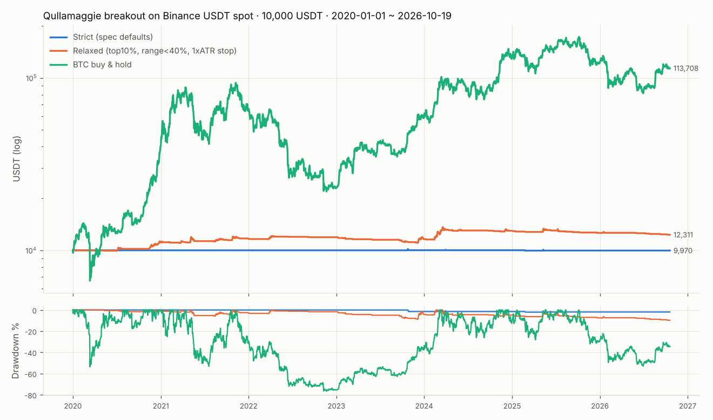

|  | 总收益 | 年化 | 最大回撤 | 夏普 | 交易数 | 胜率 | 盈亏比 | 期望值(R) |
|---|---|---|---|---|---|---|---|---|
| 严格版(需求默认参数) | -0.3% | -0.0% | -2.0% | -0.04 | 4 | 50.0% | 0.45 | -0.149 |
| 放宽版 | 23.1% | 3.1% | -9.7% | 0.53 | 120 | 40.8% | 2.45 | 0.360 |
| BTC 买入持有 | 1037.1% | 43.0% | -76.6% | 0.90 | — | — | — | — |

- 放宽版:平均盈利 2.15R,平均亏损 -0.88R,累计 43.2R,
  被止损比例 45.8%,最多连续止损 5 次;平均持仓市值只占账户 1.4%
  ——0.5% 风险 + 信号稀少,资金大部分时间闲置,所以收益率绝对值很低。
- 放宽版离场原因:stop 55, breakeven_stop 49, ma_exit 16

### 回撤、持续时间与连亏(按每日收盘权益)

|  | 最大回撤 | 峰值日 | 谷底日 | 下跌天数 | 收复前高日 | 恢复天数 | 回撤总时长(天) | 最长水下期(天) | 最长连亏(笔) | 最多连续止损(笔) |
|---|---|---|---|---|---|---|---|---|---|---|
| 严格版 | -2.0% | 2023-10-25 | 2025-02-24 | 488 | 未收复 | > 602 | 1090 | 1089 | 2 | 1 |
| 放宽版 | -9.7% | 2024-03-18 | 2026-10-08 | 934 | 未收复 | > 11 | 945 | 944 | 8 | 5 |
| BTC 买入持有 | -76.6% | 2021-11-08 | 2022-11-21 | 378 | 2024-03-04 | 469 | 847 | 846 | — | — |

“下跌天数”= 峰值到谷底;“恢复天数”= 谷底到重新创新高;“最长水下期”= 任意一次从前高跌下去到收复前高的最长天数
(到数据结束仍未收复则算到最后一天)。“最长连亏”= 按平仓顺序,净盈亏 ≤ 0 的连续笔数(包含保本止损扣完手续费后的小亏)。

### 蒙特卡洛:打乱交易顺序 1000 次的最大回撤分布(放宽版)

历史只是这 120 笔交易的**一种**排列顺序。把顺序随机打乱 1000 次、逐笔复利,看最大回撤会有多深
(按逐笔平仓计算,不含持仓中的浮动盈亏和多笔重叠,所以“实际顺序”一列与上表的日线回撤略有差别)。

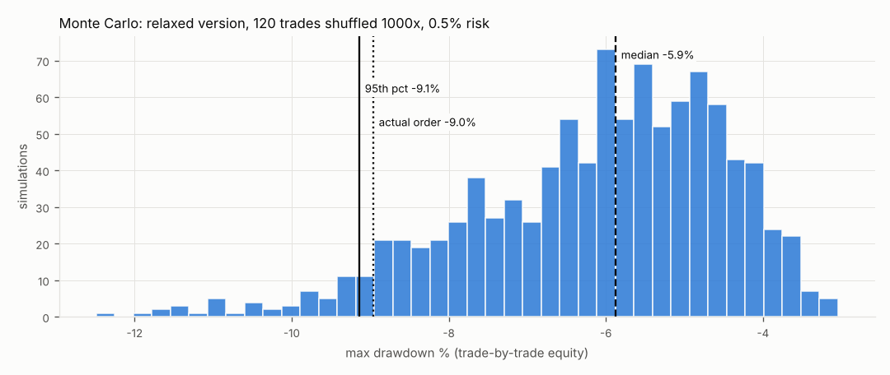

|  | 实际顺序 | 中位数 | 95% 分位 | 99% 分位 | 1000 次中最差 |
|---|---|---|---|---|---|
| 每笔风险 0.5% | -9.0% | -5.9% | -9.1% | -10.9% | -12.5% |
| 每笔风险 1%(约 ×2) | -17.2% | -11.5% | -17.5% | -20.7% | -23.6% |

| 以 R 计(与风险比例无关) | 实际顺序 | 中位数 | 95% 分位 | 99% 分位 |
|---|---|---|---|---|
| 最大回撤(R) | -18.7R | -12.0R | -19.0R | -22.9R |
| 最长连亏(笔) | 8 | 8 | 12 | 15 |

**实盘刹车线建议**(以 0.5% 风险为例;用 R 表示的版本对任何风险比例都适用):

- **预警线 ≈ -5.9%(约 -12R)**:一半的随机顺序都会走到这么深,属于正常波动。到这里把每笔风险减半,不改规则。
- **刹车线 ≈ -9.1%(约 -19R)**:只有 5% 的随机顺序会这么深。实盘回撤超过它,更可能是
  “市场变了 / 策略失效”而不是运气差 → 停止开新仓,复查最近的交易和行情环境,至少等样本外重新验证再恢复。
- **连亏复查线 ≈ 15 笔**:超过 99% 分位的连续亏损笔数,同样触发复查。
- 注意:蒙特卡洛只打乱了**已有**交易的顺序,假设未来交易的分布和过去一样;
  如果优势本身在衰减(见第 8 节样本外),真实回撤可能比 99% 分位还深,所以刹车线宁紧勿松。

### 分年份(放宽版;交易按开仓年份)

| 年份 | 收益 | 年内最大回撤 | 夏普 | BTC 收益 | 交易数 | 胜率 | 期望(R) | 累计R | 严格版交易数 |
|---|---|---|---|---|---|---|---|---|---|
| 2020 | 12.1% | -2.4% | 2.05 | 301.7% | 5 | 60.0% | 4.339 | 21.69 | 0 |
| 2021 | 3.9% | -5.8% | 0.56 | 59.8% | 26 | 53.8% | 0.371 | 9.64 | 0 |
| 2022 | 2.2% | -1.7% | 0.68 | -64.2% | 11 | 45.5% | 0.396 | 4.36 | 0 |
| 2023 | -2.5% | -7.3% | -0.44 | 155.6% | 29 | 24.1% | -0.160 | -4.64 | 1 |
| 2024 | 11.8% | -5.7% | 1.24 | 121.3% | 25 | 52.0% | 0.904 | 22.60 | 1 |
| 2025 | -2.8% | -5.6% | -0.49 | -6.3% | 18 | 33.3% | -0.308 | -5.55 | 2 |
| 2026 | -2.4% | -3.7% | -1.63 | -6.5% | 6 | 16.7% | -0.815 | -4.89 | 0 |

### 严格版全部交易

| symbol | signal_date | entry_date | exit_date | entry_price | stop_pct | hold_days | pnl | R | exit_reason |
|---|---|---|---|---|---|---|---|---|---|
| LQTYUSDT | 2023-10-24 | 2023-10-25 | 2023-10-31 | 1.63582 | 7.4% | 6 | 11.7 | +0.23 | breakeven_stop |
| DEXEUSDT | 2024-03-29 | 2024-03-30 | 2024-04-02 | 14.7884 | 7.0% | 3 | -0.8 | -0.02 | breakeven_stop |
| OMUSDT | 2025-02-23 | 2025-02-24 | 2025-02-24 | 8.50225 | 3.8% | 0 | -53.3 | -1.06 | stop |
| MKRUSDT | 2025-05-09 | 2025-05-10 | 2025-05-13 | 1738.87 | 3.0% | 3 | 12.5 | +0.25 | breakeven_stop |

### 放宽版最好的 10 笔

| symbol | signal_date | entry_date | exit_date | entry_price | stop_pct | hold_days | pnl | R | exit_reason |
|---|---|---|---|---|---|---|---|---|---|
| WAVESUSDT | 2020-11-09 | 2020-11-10 | 2020-12-19 | 3.8016 | 6.4% | 39 | 566.8 | +11.12 | ma_exit |
| AVAXUSDT | 2023-12-05 | 2023-12-06 | 2023-12-29 | 24.5523 | 6.1% | 23 | 446.5 | +8.09 | ma_exit |
| COTIUSDT | 2024-02-23 | 2024-02-24 | 2024-03-15 | 0.124792 | 10.7% | 20 | 471.6 | +7.85 | ma_exit |
| ZILUSDT | 2020-12-16 | 2020-12-17 | 2021-01-11 | 0.0391796 | 9.8% | 25 | 365.0 | +6.74 | ma_exit |
| IDUSDT | 2024-03-07 | 2024-03-08 | 2024-03-22 | 0.735938 | 10.0% | 14 | 404.8 | +6.52 | ma_exit |
| SHIBUSDT | 2021-10-24 | 2021-10-25 | 2021-11-10 | 3.6068e-05 | 11.7% | 16 | 362.7 | +6.34 | ma_exit |
| BNXUSDT | 2022-03-31 | 2022-04-01 | 2022-04-22 | 62.9314 | 9.3% | 21 | 354.0 | +6.02 | ma_exit |
| OMUSDT | 2024-03-15 | 2024-03-16 | 2024-04-07 | 0.433457 | 11.5% | 22 | 391.3 | +5.97 | ma_exit |
| ETCUSDT | 2021-05-03 | 2021-05-04 | 2021-05-19 | 52.091 | 10.1% | 15 | 284.4 | +5.12 | breakeven_stop |
| VETUSDT | 2020-07-04 | 2020-07-05 | 2020-07-21 | 0.0125323 | 6.3% | 16 | 248.4 | +4.99 | ma_exit |

### 放宽版最差的 10 笔

| symbol | signal_date | entry_date | exit_date | entry_price | stop_pct | hold_days | pnl | R | exit_reason |
|---|---|---|---|---|---|---|---|---|---|
| MKRUSDT | 2023-09-20 | 2023-09-21 | 2023-09-22 | 1347.67 | 4.2% | 1 | -60.8 | -1.06 | stop |
| BCHUSDT | 2025-05-22 | 2025-05-23 | 2025-05-24 | 444.722 | 5.2% | 1 | -69.3 | -1.05 | stop |
| LUNAUSDT | 2022-03-29 | 2022-03-30 | 2022-03-31 | 109.085 | 5.4% | 1 | -61.7 | -1.04 | stop |
| OGUSDT | 2025-09-09 | 2025-09-10 | 2025-09-10 | 23.3417 | 5.6% | 0 | -66.8 | -1.04 | stop |
| GHSTUSDT | 2023-03-07 | 2023-03-08 | 2023-03-08 | 1.65283 | 5.6% | 0 | -60.8 | -1.04 | stop |
| RUNEUSDT | 2023-09-29 | 2023-09-30 | 2023-10-01 | 1.998 | 5.7% | 1 | -59.2 | -1.04 | stop |
| BCHUSDT | 2025-12-19 | 2025-12-20 | 2025-12-20 | 625.112 | 5.8% | 0 | -66.1 | -1.04 | stop |
| XRPUSDT | 2025-01-15 | 2025-01-16 | 2025-01-16 | 3.14457 | 5.9% | 0 | -67.2 | -1.04 | stop |
| LINKUSDT | 2023-12-08 | 2023-12-09 | 2023-12-10 | 16.9345 | 5.9% | 1 | -59.2 | -1.04 | stop |
| AAVEUSDT | 2025-06-10 | 2025-06-11 | 2025-06-12 | 308.474 | 6.2% | 1 | -68.0 | -1.04 | stop |

全部明细:`results/trades_strict.csv`、`results/trades_relaxed.csv`

## 4. 选币方式 × 止损方式

其余规则完全相同(次日开盘买、0.5% 风险、25% 上限、第 3 天卖 1/3 + 保本止损、均线离场、同样的成本)。
“24h 涨幅榜 / 成交额榜前 10”= 每天收盘在流动性合格的币里取排名前 10,次日开盘买入(已持有的跳过)。
“被止损比例”= 被**初始止损**打掉的交易占比(不含部分止盈后的保本止损);“最多连续止损”按平仓时间顺序统计。
ATR 止损时仓位按止损距离反算,每笔风险仍是 0.5%(除非被 25% 仓位上限截断,见最后一列)。
“原方案·放宽版”这里用放宽版的选币条件,配合三种止损。

| 选币 | 止损 | 交易数 | 被止损比例 | 最多连续止损 | 最长连亏 | 胜率 | 期望值(R) | R 中位数 | 总收益 | 最大回撤 | 夏普 | 仓位被25%上限截断 |
|---|---|---|---|---|---|---|---|---|---|---|---|---|
| 原方案·严格版 | 突破日最低点(>1ATR 放弃) | 4 | 25.0% | 1 | 2 | 50.0% | -0.149 | 0.11 | -0.3% | -2.0% | -0.04 | 0% |
| 原方案·严格版 | 1×ATR | 13 | 23.1% | 1 | 4 | 38.5% | 0.222 | -0.03 | 1.4% | -2.6% | 0.16 | 0% |
| 原方案·严格版 | 2×ATR | 13 | 7.7% | 1 | 4 | 38.5% | 0.068 | -0.01 | 0.4% | -1.4% | 0.09 | 0% |
| 原方案·放宽版 | 突破日最低点(>1ATR 放弃) | 23 | 47.8% | 5 | 5 | 47.8% | 1.151 | -0.23 | 13.5% | -4.9% | 0.54 | 4% |
| 原方案·放宽版 | 1×ATR | 120 | 45.8% | 5 | 8 | 40.8% | 0.360 | -0.51 | 23.1% | -9.7% | 0.53 | 0% |
| 原方案·放宽版 | 2×ATR | 118 | 13.6% | 2 | 6 | 48.3% | 0.238 | -0.01 | 14.8% | -5.8% | 0.58 | 0% |
| 24h 涨幅榜前 10 | 突破日最低点(>1ATR 放弃) | 7286 | 52.1% | 40 | 40 | 29.7% | -0.055 | -1.02 | -99.6% | -100.0% | -0.98 | 18% |
| 24h 涨幅榜前 10 | 1×ATR | 10703 | 38.4% | 28 | 31 | 33.3% | -0.047 | -0.39 | -99.6% | -100.0% | -0.75 | 17% |
| 24h 涨幅榜前 10 | 2×ATR | 13177 | 10.5% | 15 | 31 | 36.7% | -0.027 | -0.13 | -97.0% | -99.7% | -0.57 | 4% |
| 24h 成交额榜前 10 | 突破日最低点(>1ATR 放弃) | 5628 | 65.0% | 53 | 62 | 25.8% | 0.046 | -1.05 | -64.9% | -96.2% | 0.02 | 45% |
| 24h 成交额榜前 10 | 1×ATR | 6155 | 37.0% | 24 | 35 | 37.9% | 0.011 | -0.25 | -71.6% | -97.1% | -0.10 | 8% |
| 24h 成交额榜前 10 | 2×ATR | 5648 | 12.0% | 11 | 29 | 41.1% | 0.018 | -0.07 | 2.1% | -76.7% | 0.17 | 0% |

## 5. 条件消融:去掉某一个条件,结果变好还是变坏?

判断标准:去掉后**每笔期望值(R)下降**说明这个条件在帮忙;上升说明它没用甚至有害;变化 < 0.05R 视为影响小。
同时给出 2020–23 与 2024– 两段的期望值,看结论在两段是否一致。注意:去掉条件通常会多出很多交易,
即使期望值略降,累计 R 也可能更高——这两列要一起看。

**放宽版**(基准 120 笔):

|  | 交易数 | 期望(R) | 累计R | 总收益 | 夏普 | 最大回撤 | 期望R·2020–23 | 期望R·2024– | 结论 |
|---|---|---|---|---|---|---|---|---|---|
| 基准(全部条件) | 120 | 0.360 | 43.2 | 23.1% | 0.53 | -9.7% | 0.437 | 0.248 |  |
| 去掉 1. 之前强势(1/3 个月涨幅前 N%) | 476 | 0.483 | 229.9 | 168.2% | 0.89 | -22.6% | 0.666 | 0.154 | 没用/有害:去掉后期望 +0.12R |
| 去掉 2a. 区间收窄((高-低)/收盘 < X%) | 141 | 0.294 | 41.4 | 21.8% | 0.46 | -10.8% | 0.374 | 0.168 | **有用**:去掉后期望 -0.07R |
| 去掉 2b. 横盘 ATR 低于上涨阶段 ATR | 126 | 0.400 | 50.5 | 27.6% | 0.60 | -10.1% | 0.524 | 0.220 | 影响小(+0.04R) |
| 去掉 3. 横盘成交量萎缩 | 259 | 0.324 | 83.9 | 45.9% | 0.62 | -17.2% | 0.622 | -0.080 | 影响小(-0.04R) |
| 去掉 4. 贴近 60 日高点 | 312 | 0.282 | 87.9 | 50.1% | 0.65 | -17.3% | 0.434 | -0.010 | **有用**:去掉后期望 -0.08R |
| 去掉 5. 站上 10/20 日均线且 20 日线向上 | 124 | 0.337 | 41.8 | 22.2% | 0.50 | -9.4% | 0.406 | 0.238 | 影响小(-0.02R) |
| 去掉 买入:突破日放量 | 173 | 0.315 | 54.5 | 29.3% | 0.57 | -16.0% | 0.627 | -0.048 | 影响小(-0.05R) |

**严格版**(基准只有 4 笔,结论仅供参考):

|  | 交易数 | 期望(R) | 累计R | 总收益 | 夏普 | 最大回撤 | 期望R·2020–23 | 期望R·2024– | 结论 |
|---|---|---|---|---|---|---|---|---|---|
| 基准(全部条件) | 4 | -0.149 | -0.6 | -0.3% | -0.04 | -2.0% | 0.235 | -0.276 |  |
| 去掉 1. 之前强势(1/3 个月涨幅前 N%) | 106 | 0.076 | 8.1 | 2.3% | 0.09 | -15.8% | -0.257 | 0.698 | 没用/有害:去掉后期望 +0.23R |
| 去掉 2a. 区间收窄((高-低)/收盘 < X%) | 6 | 0.921 | 5.5 | 2.7% | 0.20 | -2.9% | 1.585 | -0.407 | 没用/有害:去掉后期望 +1.07R |
| 去掉 2b. 横盘 ATR 低于上涨阶段 ATR | 4 | -0.149 | -0.6 | -0.3% | -0.04 | -2.0% | 0.235 | -0.276 | 影响小(+0.00R) |
| 去掉 3. 横盘成交量萎缩 | 8 | -0.028 | -0.2 | -0.1% | -0.01 | -3.0% | 0.407 | -0.288 | 没用/有害:去掉后期望 +0.12R |
| 去掉 4. 贴近 60 日高点 | 9 | 1.267 | 11.4 | 5.7% | 0.37 | -2.7% | 3.028 | -0.142 | 没用/有害:去掉后期望 +1.42R |
| 去掉 5. 站上 10/20 日均线且 20 日线向上 | 4 | -0.149 | -0.6 | -0.3% | -0.04 | -2.0% | 0.235 | -0.276 | 影响小(+0.00R) |
| 去掉 买入:突破日放量 | 9 | -0.525 | -4.7 | -2.3% | -0.29 | -2.9% | -0.629 | -0.473 | **有用**:去掉后期望 -0.38R |

## 6. 参数敏感性

需求要求的组合:强势前 1%/2%/5% × 10/20 日均线离场 × 0.5%/1% 风险,两个版本各 12 组(放宽版里“前 N%”替换掉它的 10%)。

| 版本 | 前N% | 均线 | 风险 | 总收益 | 年化 | 最大回撤 | 夏普 | 交易数 | 胜率 | 盈亏比 | 期望值(R) |
|---|---|---|---|---|---|---|---|---|---|---|---|
| 严格版 | 1% | 10 | 0.5% | -0.4% | -0.1% | -1.3% | -0.09 | 3 | 33.3% | 0.46 | -0.276 |
| 严格版 | 1% | 10 | 1.0% | -0.8% | -0.1% | -2.5% | -0.10 | 3 | 33.3% | 0.46 | -0.276 |
| 严格版 | 1% | 20 | 0.5% | -0.4% | -0.1% | -1.3% | -0.09 | 3 | 33.3% | 0.46 | -0.276 |
| 严格版 | 1% | 20 | 1.0% | -0.8% | -0.1% | -2.5% | -0.10 | 3 | 33.3% | 0.46 | -0.276 |
| 严格版 | 2% | 10 | 0.5% | -0.3% | -0.0% | -2.0% | -0.04 | 4 | 50.0% | 0.45 | -0.149 |
| 严格版 | 2% | 10 | 1.0% | -0.6% | -0.1% | -3.9% | -0.04 | 4 | 50.0% | 0.45 | -0.149 |
| 严格版 | 2% | 20 | 0.5% | -0.3% | -0.0% | -2.0% | -0.04 | 4 | 50.0% | 0.45 | -0.149 |
| 严格版 | 2% | 20 | 1.0% | -0.6% | -0.1% | -3.9% | -0.04 | 4 | 50.0% | 0.45 | -0.149 |
| 严格版 | 5% | 10 | 0.5% | 0.5% | 0.1% | -2.5% | 0.06 | 6 | 50.0% | 1.44 | 0.154 |
| 严格版 | 5% | 10 | 1.0% | 0.9% | 0.1% | -4.9% | 0.06 | 6 | 50.0% | 1.44 | 0.154 |
| 严格版 | 5% | 20 | 0.5% | -0.4% | -0.1% | -2.6% | -0.04 | 6 | 50.0% | 0.60 | -0.140 |
| 严格版 | 5% | 20 | 1.0% | -0.9% | -0.1% | -5.0% | -0.04 | 6 | 50.0% | 0.60 | -0.140 |
| 放宽版 | 1% | 10 | 0.5% | 4.8% | 0.7% | -5.5% | 0.24 | 25 | 36.0% | 2.98 | 0.391 |
| 放宽版 | 1% | 10 | 1.0% | 9.5% | 1.3% | -10.6% | 0.25 | 25 | 36.0% | 2.98 | 0.391 |
| 放宽版 | 1% | 20 | 0.5% | 4.0% | 0.6% | -4.7% | 0.20 | 25 | 36.0% | 2.79 | 0.327 |
| 放宽版 | 1% | 20 | 1.0% | 7.9% | 1.1% | -9.1% | 0.21 | 25 | 36.0% | 2.79 | 0.327 |
| 放宽版 | 2% | 10 | 0.5% | 10.1% | 1.4% | -4.7% | 0.41 | 40 | 42.5% | 2.73 | 0.496 |
| 放宽版 | 2% | 10 | 1.0% | 20.5% | 2.8% | -9.2% | 0.42 | 40 | 42.5% | 2.73 | 0.496 |
| 放宽版 | 2% | 20 | 0.5% | 7.6% | 1.1% | -5.4% | 0.30 | 40 | 42.5% | 2.39 | 0.375 |
| 放宽版 | 2% | 20 | 1.0% | 15.3% | 2.1% | -10.0% | 0.32 | 40 | 42.5% | 2.39 | 0.375 |
| 放宽版 | 5% | 10 | 0.5% | 14.2% | 2.0% | -6.5% | 0.48 | 73 | 43.8% | 2.26 | 0.376 |
| 放宽版 | 5% | 10 | 1.0% | 29.4% | 3.9% | -12.5% | 0.49 | 73 | 43.8% | 2.26 | 0.376 |
| 放宽版 | 5% | 20 | 0.5% | 12.6% | 1.8% | -6.5% | 0.40 | 72 | 44.4% | 2.13 | 0.340 |
| 放宽版 | 5% | 20 | 1.0% | 25.7% | 3.4% | -12.7% | 0.41 | 72 | 44.4% | 2.13 | 0.340 |

瓶颈参数(强势前 N% × 横盘区间上限;其他为严格版默认):

| 强势前N% | 横盘区间< | 低点止损·交易数 | 低点止损·期望(R) | 低点止损·总收益 | 1ATR止损·交易数 | 1ATR止损·期望(R) | 1ATR止损·总收益 |
|---|---|---|---|---|---|---|---|
| 2% | 20% | 4 | -0.149 | -0.3% | 13 | 0.222 | 1.4% |
| 2% | 30% | 4 | 1.623 | 3.2% | 25 | 0.585 | 7.4% |
| 2% | 40% | 6 | 0.921 | 2.7% | 40 | 0.375 | 7.6% |
| 5% | 20% | 6 | -0.140 | -0.4% | 23 | 0.189 | 2.2% |
| 5% | 30% | 12 | 1.231 | 7.2% | 48 | 0.452 | 11.1% |
| 5% | 40% | 15 | 1.479 | 11.2% | 72 | 0.340 | 12.6% |
| 10% | 20% | 11 | -0.112 | -0.6% | 51 | 0.196 | 4.8% |
| 10% | 30% | 20 | 0.952 | 9.4% | 90 | 0.486 | 23.7% |
| 10% | 40% | 23 | 1.151 | 13.5% | 120 | 0.360 | 23.1% |
| 20% | 20% | 33 | 0.045 | 0.6% | 111 | 0.401 | 23.4% |
| 20% | 30% | 54 | 0.869 | 25.1% | 183 | 0.564 | 64.3% |
| 20% | 40% | 58 | 0.891 | 28.0% | 225 | 0.482 | 68.1% |

## 7. 交易 K 线图(人工核对用)

灰底 = 横盘区间,虚线 = 区间最高价 / 横盘均量,breakout 箭头 = 突破日,▲ = 次日开盘买入,红线 = 止损
(点线 = 部分止盈后移到成本价),▼ = 卖出 1/3,✕ = 最终离场;蓝/紫线 = MA10 / MA20。
前 4 张是严格版全部交易,其余是放宽版最好 2 笔、最差 2 笔、随机 2 笔。

**1. 严格版 · LQTYUSDT** — 信号日 2023-10-24,横盘 7 天,买入 1.636,止损 1.514(−7.4%),2023-10-31 breakeven_stop 离场,R = +0.23

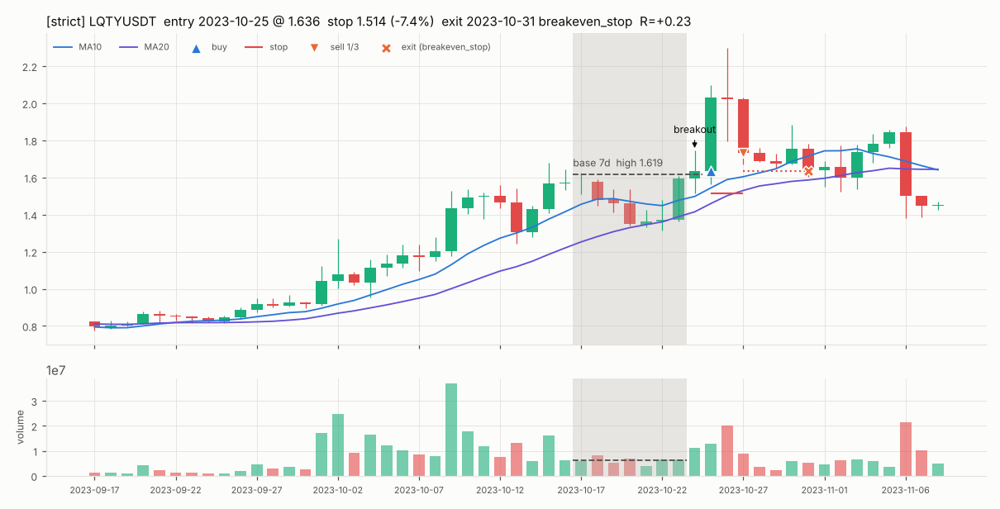

**2. 严格版 · DEXEUSDT** — 信号日 2024-03-29,横盘 5 天,买入 14.79,止损 13.75(−7.0%),2024-04-02 breakeven_stop 离场,R = -0.02

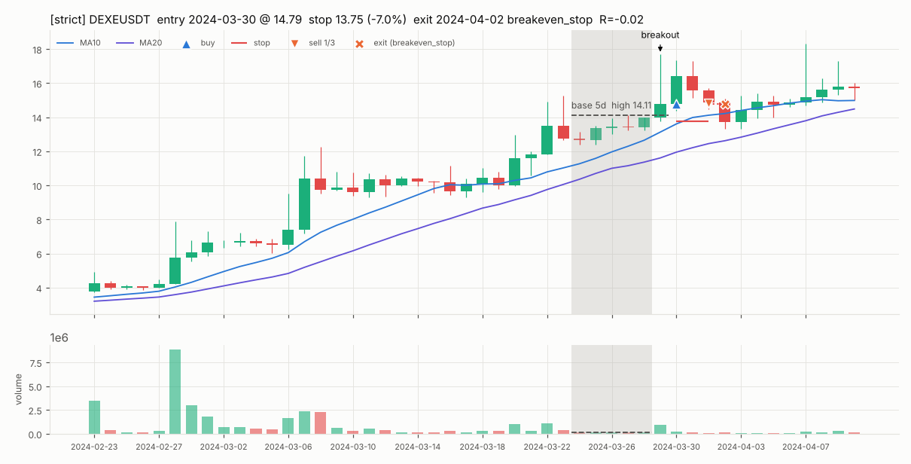

**3. 严格版 · OMUSDT** — 信号日 2025-02-23,横盘 7 天,买入 8.502,止损 8.178(−3.8%),2025-02-24 stop 离场,R = -1.06

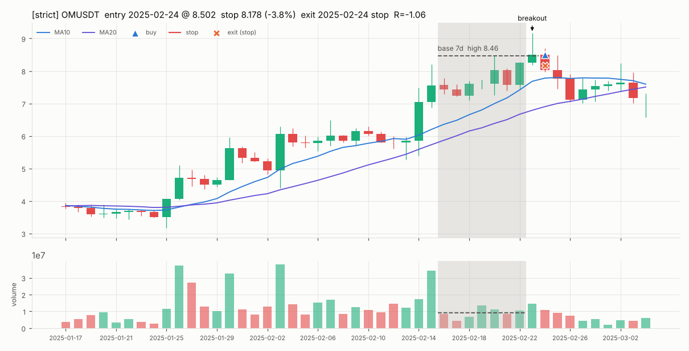

**4. 严格版 · MKRUSDT** — 信号日 2025-05-09,横盘 15 天,买入 1739,止损 1687(−3.0%),2025-05-13 breakeven_stop 离场,R = +0.25

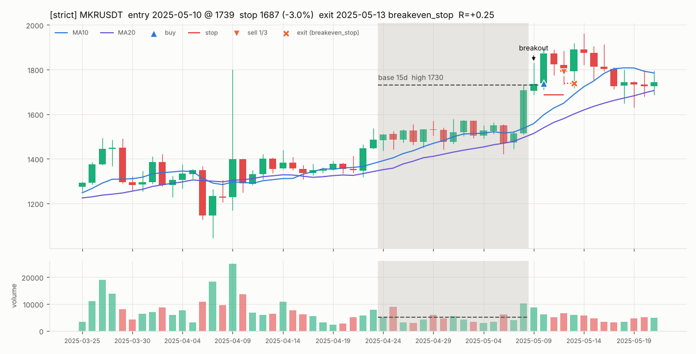

**5. 放宽版 · WAVESUSDT** — 信号日 2020-11-09,横盘 15 天,买入 3.802,止损 3.559(−6.4%),2020-12-19 ma_exit 离场,R = +11.12

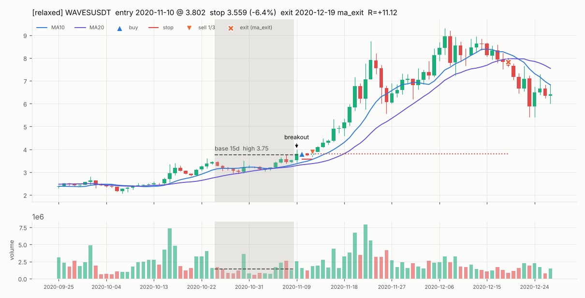

**6. 放宽版 · AVAXUSDT** — 信号日 2023-12-05,横盘 15 天,买入 24.55,止损 23.06(−6.1%),2023-12-29 ma_exit 离场,R = +8.09

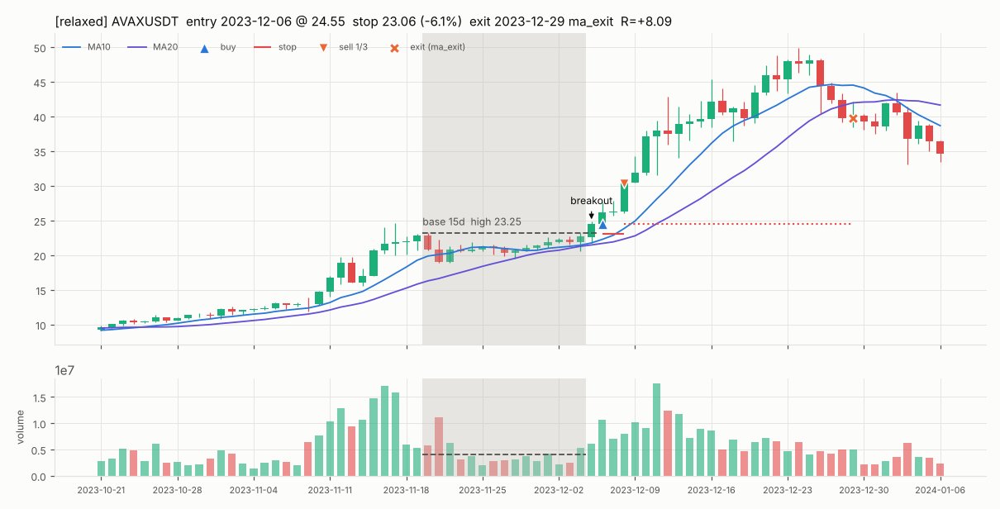

**7. 放宽版 · MKRUSDT** — 信号日 2023-09-20,横盘 15 天,买入 1348,止损 1291(−4.2%),2023-09-22 stop 离场,R = -1.06

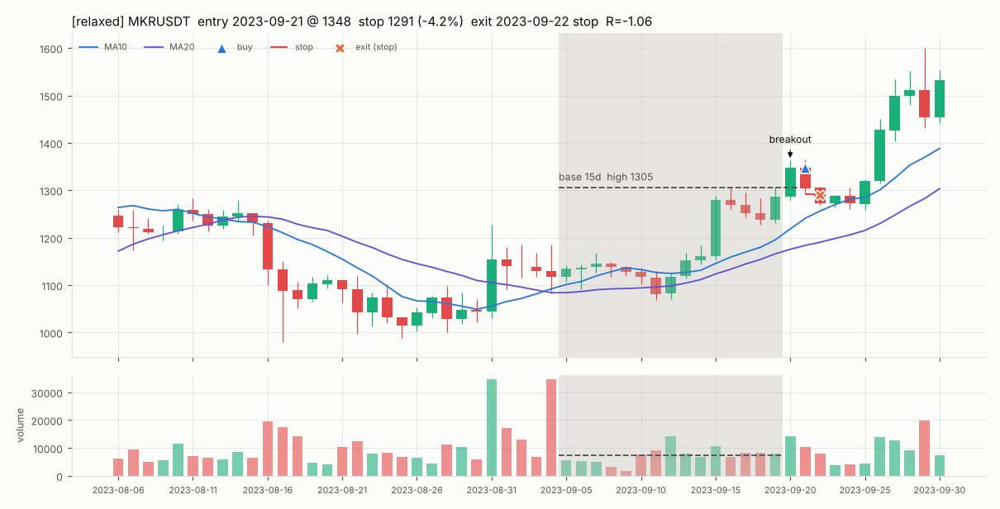

**8. 放宽版 · BCHUSDT** — 信号日 2025-05-22,横盘 12 天,买入 444.7,止损 421.5(−5.2%),2025-05-24 stop 离场,R = -1.05

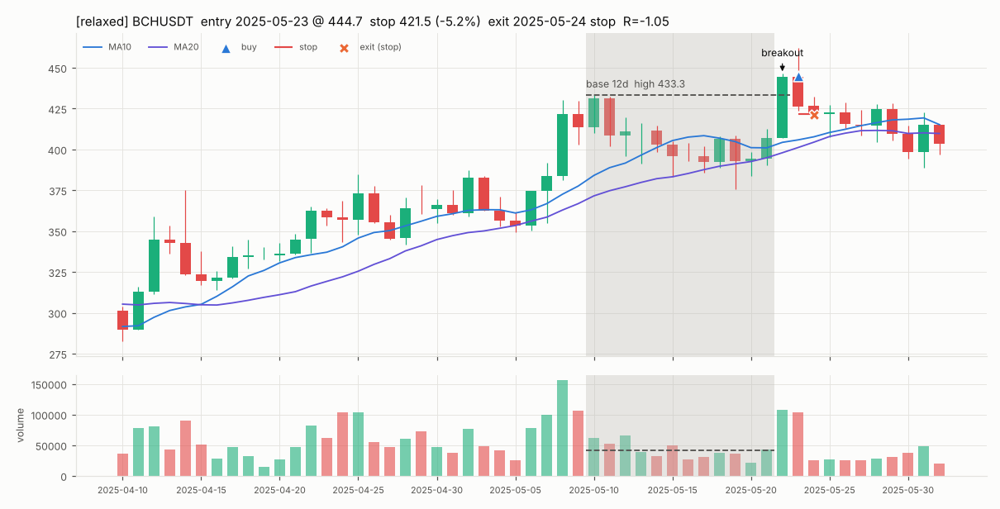

**9. 放宽版 · IDUSDT** — 信号日 2024-03-07,横盘 15 天,买入 0.7359,止损 0.6623(−10.0%),2024-03-22 ma_exit 离场,R = +6.52

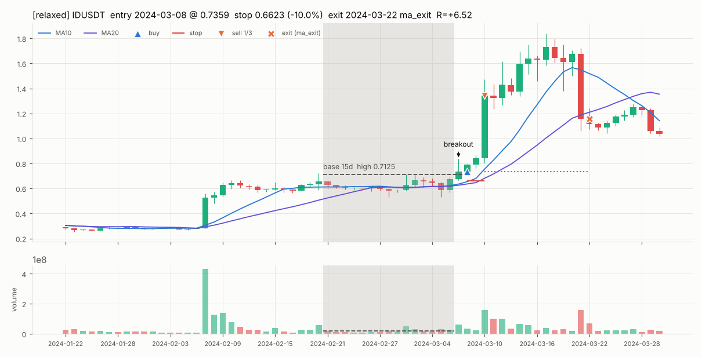

**10. 放宽版 · LUNAUSDT** — 信号日 2021-11-03,横盘 11 天,买入 48.01,止损 44.09(−8.2%),2021-11-10 breakeven_stop 离场,R = +0.24

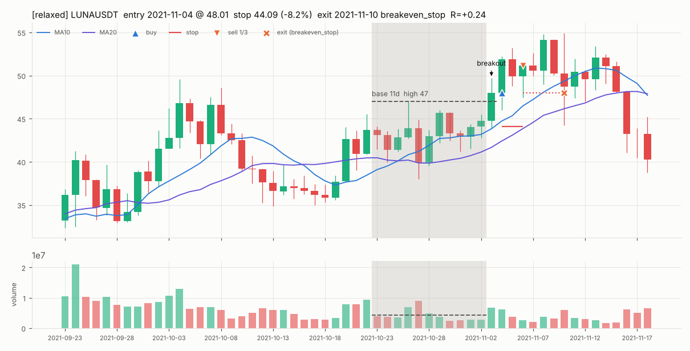

## 8. 样本外检验

做法:在 288 组参数(强势前 2/5/10/20% × 横盘区间 20/30/40% × 缩量 70%/不要求 × 放量 1.0/1.5 倍 ×
止损 3 种 × 均线 10/20)里,只用 **2020–2023** 按夏普挑最优(要求 ≥ 30 笔),再原封不动拿到 **2024-01-01 至今**,初始资金重置为 10,000。

- 样本内最优:强势前 20% / 横盘区间 < 40% / 横盘量 < 70% × 上涨期量 / 突破量 ≥ 1× 横盘均量 / 止损 2×ATR / MA10 离场
- 全部参数组样本内 vs 样本外夏普的**秩相关 0.37**(接近 1 = 样本内好的样本外也好;≈ 0 或负 = 调参在拟合噪声)
- 期望值为正的参数组占比:样本内 98%,样本外 32%

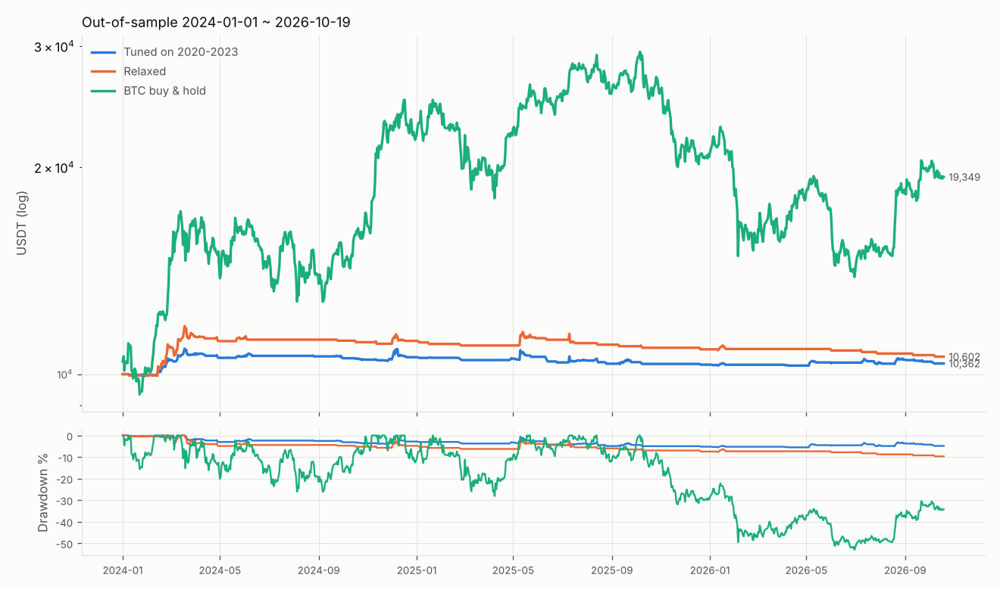

|  | 总收益 | 年化 | 最大回撤 | 夏普 | 交易数 | 胜率 | 盈亏比 | 期望值(R) |
|---|---|---|---|---|---|---|---|---|
| 样本内 2020–2023 · 样本内最优参数 | 40.1% | 8.8% | -4.7% | 1.60 | 170 | 48.8% | 2.74 | 0.410 |
| 样本外 2024–至今 · 样本内最优参数 | 3.6% | 1.3% | -5.6% | 0.30 | 126 | 41.3% | 1.75 | 0.058 |
| 样本内 2020–2023 · 严格版 | 0.1% | 0.0% | -1.5% | 0.03 | 1 | 100.0% | — | 0.235 |
| 样本外 2024–至今 · 严格版 | -0.4% | -0.1% | -1.3% | -0.13 | 3 | 33.3% | 0.46 | -0.276 |
| 样本内 2020–2023 · 放宽版 | 16.1% | 3.8% | -8.9% | 0.67 | 71 | 40.8% | 2.68 | 0.437 |
| 样本外 2024–至今 · 放宽版 | 6.0% | 2.1% | -9.7% | 0.35 | 49 | 40.8% | 2.13 | 0.248 |
| 样本内 2020–2023 · BTC 持有 | 486.8% | 55.6% | -76.6% | 1.00 | — | — | — | — |
| 样本外 2024–至今 · BTC 持有 | 93.5% | 26.6% | -53.0% | 0.74 | — | — | — | — |

样本内夏普前 10 的参数组及其样本外表现:

| 强势前N% | 区间< | 缩量< | 放量≥ | 止损 | 均线 | 内·笔数 | 内·夏普 | 内·期望R | 外·笔数 | 外·夏普 | 外·期望R | 外·总收益 |
|---|---|---|---|---|---|---|---|---|---|---|---|---|
| 20% | 40% | 70% | 1.0 | 2×ATR | 10 | 170 | 1.60 | 0.410 | 126 | 0.30 | 0.058 | 3.6% |
| 20% | 40% | 100% | 1.0 | 2×ATR | 10 | 326 | 1.56 | 0.306 | 244 | 0.18 | 0.027 | 3.0% |
| 20% | 40% | 100% | 1.5 | 2×ATR | 10 | 253 | 1.56 | 0.356 | 170 | 0.37 | 0.076 | 6.4% |
| 20% | 20% | 100% | 1.0 | 2×ATR | 10 | 146 | 1.55 | 0.380 | 132 | 0.43 | 0.070 | 4.6% |
| 20% | 20% | 100% | 1.0 | 1×ATR | 20 | 145 | 1.55 | 0.981 | 133 | -0.02 | -0.015 | -1.3% |
| 5% | 40% | 100% | 1.0 | 2×ATR | 10 | 93 | 1.52 | 0.428 | 76 | -0.49 | -0.097 | -3.7% |
| 20% | 30% | 100% | 1.0 | 1×ATR | 20 | 259 | 1.51 | 0.676 | 200 | 0.15 | 0.038 | 3.1% |
| 5% | 40% | 100% | 1.0 | 2×ATR | 20 | 86 | 1.51 | 0.691 | 76 | -0.58 | -0.120 | -4.5% |
| 20% | 40% | 100% | 1.0 | 2×ATR | 20 | 314 | 1.50 | 0.376 | 242 | 0.13 | 0.019 | 2.0% |
| 20% | 40% | 70% | 1.0 | 2×ATR | 20 | 167 | 1.50 | 0.452 | 126 | 0.13 | 0.026 | 1.5% |

完整网格:`results/optimization_grid.csv`

## 9. 10 USDT 小资金的现实问题(以放宽版为例)

币安现货多数交易对最小下单金额(NOTIONAL 过滤器)约 **5 USDT**,另有数量步长(LOT_SIZE)。

- 10U 账户每笔风险 = 10 × 0.5% = **0.05U**。放宽版止损距离中位数 9.3%,
  算出的仓位中位数 **0.54U**(25% 上限 = 2.5U),**100% 的交易低于 5U,根本下不了单**。
- 模拟 A(低于 5U 就放弃):0 笔交易。
- 模拟 B(强行按 5U 下单):112 笔,总收益 96.7%,最大回撤 -45.1%;
  每笔实际风险中位数为账户的 **2.2%**(规则 0.5%,放大约 4 倍),
  而且 5U 仓位拆不出 1/3(1.67U < 5U),部分止盈做不了,剩余部分还可能变成卖不掉的“粉尘”。
- 手续费:一次买卖成本 ≈ 2 × (0.10% + 0.05%) = 0.30% 的仓位,换成 R = 成本 ÷ 止损距离,
  中位数 **0.032R**(每笔期望 0.360R)。比例上大小账户一样,
  但小账户还要面对提币/划转固定费用、BNB 抵扣需要额外持币等问题。
- 要按规则执行(仓位和拆出的 1/3 都 ≥ 5U,覆盖 90% 交易的止损距离 ≤ 12.5%),账户至少需要约 **376U**。

## 10. 局限

- 日线回测看不到盘中先后顺序(同一天先创新高还是先打止损);滑点用固定比例,极端行情下实际更差。
- 严格版样本只有 4 笔;放宽版也只有 120 笔,期望值的置信区间很宽。
- 放宽版的放宽方向是在看过严格版交易数后决定的;虽然只按交易数选,仍属于一次“看过数据”的决定。
- 历史表现不代表未来;本项目仅用于研究,不构成投资建议。

## 11. 总结

**一、期望值:放宽版为正;严格版只有 4 笔,无法判断。** 放宽版 120 笔交易,每笔 +0.360R(胜率 40.8%,盈亏比 2.45);样本外(2024 至今)放宽版期望 0.248R,按 2020–23 调出的最优参数在样本外 0.058R,参数组样本内外夏普秩相关 0.37;期望为正的参数组从样本内 98% 掉到样本外 32%——优势存在但在 2024 年后明显衰减,样本内调出来的“最优参数”在样本外几乎没有优势。对照组“24h 涨幅榜前 10”期望 -0.047R、“24h 成交额榜前 10”0.011R(均为 1×ATR 止损)。但 0.5% 风险下资金大部分时间闲置,总收益只有 23.1%,远低于 BTC 持有的 1037.1%。 条件消融(放宽版)里,两段时间去掉后期望值都下降、即**稳定有用**的条件:2a. 区间收窄((高-低)/收盘 < X%)、4. 贴近 60 日高点、5. 站上 10/20 日均线且 20 日线向上;两段都是去掉反而更好的:无;其余条件在两段里结论不一致,说明作用不稳定。

**二、最大的风险:利润集中在少数几笔大行情,而且机会很少。** 放宽版胜率 40.8%,被初始止损打掉 45.8%,最多连续止损 5 次;最好的 10 笔合计 +68.8R,而全部交易累计只有 +43.2R——错过其中几笔,期望值就会变成负的。蒙特卡洛打乱顺序 1000 次,最大回撤中位数 -5.9%、95% 分位 -9.1%(约 -19R),最长连亏 95% 分位 12 笔——0.5% 风险下回撤幅度本身不大,真正的风险是长时间不赚钱:放宽版从 2024-03-18 的高点起至今 945 天仍未创新高,按实际顺序的逐笔回撤 -9.0% 已经接近或达到蒙特卡洛 95% 分位的刹车线——这和样本外优势衰减是同一个信号。跳空低开 / 闪崩会让单笔亏损超过 1R,止损很近时手续费 + 滑点也会把一次止损放大到 −2R 以上;下架小币有流动性风险。

**三、10U 小资金基本无法照规则执行。** 每笔风险只有 0.05U,算出的仓位 100% 低于币安 5U 最小下单额;强行每笔下 5U,实际风险变成账户的约 2.2%(规则的 4 倍),且 5U 拆不出 1/3 做部分止盈。手续费 + 滑点每笔约吃掉 0.03R(中位数),相对 +0.36R 的期望值不可忽视。要按规则执行,账户至少约 376U。
