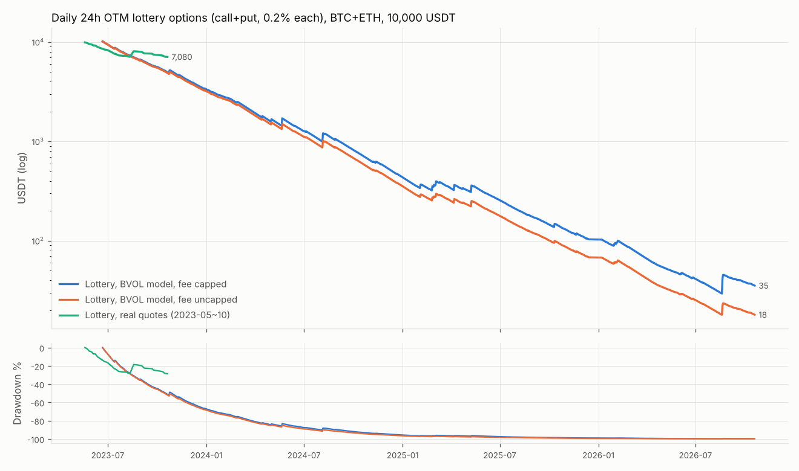
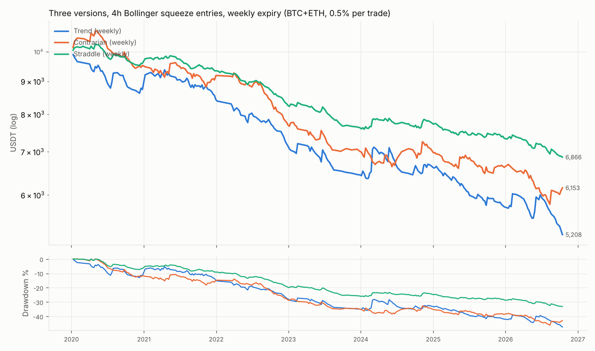
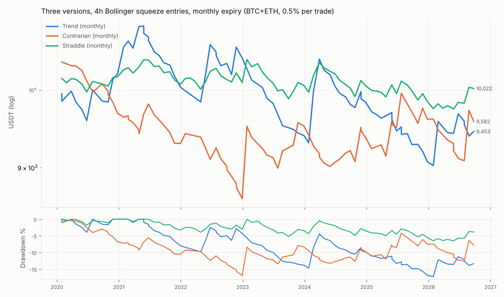
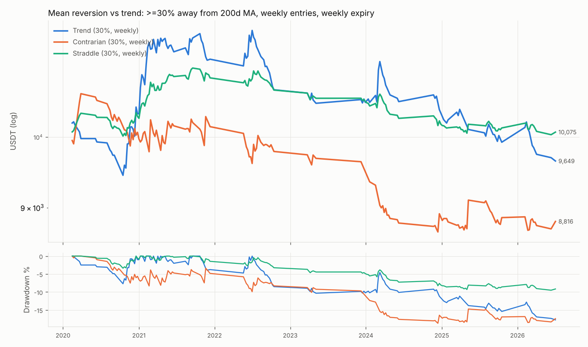
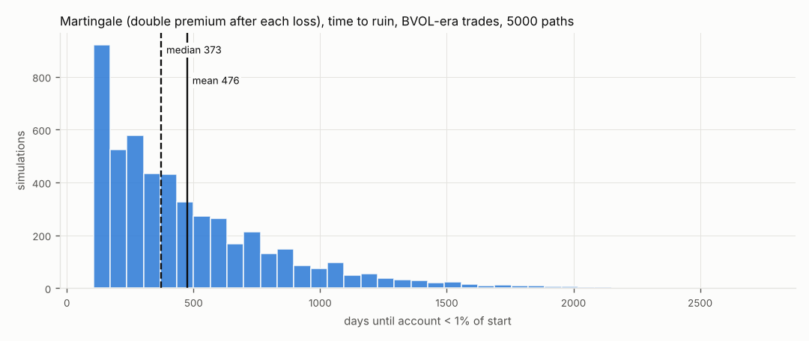

# 期权实验报告:彩票期权 · 三版本对比框架 · 马丁对照

> 纯历史数据模拟:未连接任何账户、未下任何真实订单、不需要 API 密钥。
> 生成时间 2026-10-20 10:38 UTC

## 0. 数据和最重要的局限

| 数据 | 来源 | 时间范围 | 用途 |
|---|---|---|---|
| 期权逐小时真实快照(买一/卖一/标记价/IV/Delta) | 币安 `EOHSummary` | **2023-05-18 ~ 2023-10-23** | 真实报价结果、校准、模型验证 |
| BVOL 指数(币安 BTC/ETH 30 天隐含波动率) | 币安 `BVOLIndex` | 2023-06-20 ~ 2026-10-20 | 模型定价(真实 IV 水平) |
| IV 代理(由实际波动率回归出的 BVOL 估计) | 自建,见 B5 | 2020-01 ~ 2023-06 | 模型定价(**没有任何真实 IV 数据的时段**) |
| 现货 1h / 4h / 日线 K 线 | 币安 | 2019-06 起 | 信号、市场状态、结算价 |

- 需求里写的 DVOL 是 Deribit 的指数;本运行环境的网络策略禁止访问 Deribit(以及 Tardis、OKX、Bybit、币安期权 API),
  所以用币安自己的 BVOL 代替。在云环境设置的 Network access 里允许 `history.deribit.com` 后,可以换成 Deribit 的真实历史成交重做,见
  [文档](https://code.claude.com/docs/en/cloud-environments#network-access)。
- **2020–2023 样本内的大部分期权价格是代理值**,不是真实价格;2024 年至今的样本外用真实 BVOL;
  2023 年 5–10 月有真实报价可以对照。读结果时请按这个可信度排序:真实报价 > 真实 BVOL > 代理。
- 需求的最后一句(“中文总结:哪个版本在……”)被截断了;总结按“哪个版本在哪种市场状态下表现更好、有没有稳定正期望”来写。

## A. 彩票期权(单独实验)

**规则**:每个到期日(币安每天 08:00 UTC 到期),到期前 24 小时在虚值看涨和虚值看跌中各找 |Delta| 0.02–0.05、有卖一价的合约,
选**卖一价最便宜**的一档按卖一价买入;每张花账户 0.2%(含手续费);持有期间每小时检查,买一价 ≥ 成本 × 10 卖一半,其余持有到期结算。
“中奖”= 到期有内在价值;“归零”= 到期没有价值且没卖出过一半。模型版本选 |Delta| ≥ 0.02 的最远一档。
手续费:币安期权 0.03% × 标的名义价值、行权 0.015%;网上资料未能确认是否“不超过权利金 10%”,两种都跑(默认封顶)。

### A.1 用真实快照校准(BVOL 与真实快照重叠的 2023-06-20 ~ 2023-10-23)

| 标的 | 彩票·看涨 IV÷BVOL | 彩票·看跌 IV÷BVOL | 彩票·卖一÷标记 | 彩票·买一÷标记 | 行权价间距 | 最小报价 | 校准样本 |
|---|---|---|---|---|---|---|---|
| BTCUSDT | 1.41 | 1.37 | 1.32 | 0.71 | 1.7% | 5 | 87 |
| ETHUSDT | 1.31 | 1.44 | 1.31 | 1.00 | 1.6% | 0.1 | 81 |

深度虚值翼部的隐含波动率约为 BVOL 的 **1.3–1.4 倍**(波动率微笑),卖一价又比标记价高约 **30%**。模型 vs 真实(同一段时间):

| 标的 | 数据 | 笔数 | 中奖率 | 期望值(R) | 到期价值÷卖一价 |
|---|---|---|---|---|---|
| BTCUSDT | 真实快照 | 87 | 1.15% | -0.599 | 0.551 |
| BTCUSDT | BVOL 模型 | 182 | 1.10% | -0.727 | 0.408 |
| ETHUSDT | 真实快照 | 81 | 1.23% | -0.474 | 0.147 |
| ETHUSDT | BVOL 模型 | 219 | 0.91% | -0.873 | 0.121 |

### A.2 真实快照结果(2023-05-18 ~ 2023-10-23)

| 标的 | 笔数 | 中奖率(到期有价值) | ≥10倍 | ≥40倍 | 最大倍数 | 期望值(R)·费率封顶 | 期望值(R)·不封顶 | 最长连续归零 | 到期价值÷卖一价 | 到期价值÷标记价 [95%区间] | 卖一÷标记价 |
|---|---|---|---|---|---|---|---|---|---|---|---|
| BTCUSDT | 129 | 0.78% | 1 笔 (0.78%) | 0 笔 (0.00%) | 34.9× | -0.729 | -0.840 | 95 | 0.357 | 0.41 [0.00, 1.28] | 1.43 |
| ETHUSDT | 121 | 0.83% | 1 笔 (0.83%) | 0 笔 (0.00%) | 37.7× | -0.607 | -0.731 | 48 | 0.090 | 0.12 [0.00, 0.38] | 1.33 |
| BNBUSDT | 84 | 1.19% | 0 笔 (0.00%) | 0 笔 (0.00%) | 0.2× | -0.998 | -0.999 | 71 | 0.003 | 0.01 [0.00, 0.02] | 1.00 |
| XRPUSDT | 21 | 4.76% | 0 笔 (0.00%) | 0 笔 (0.00%) | 7.9× | -0.625 | -0.625 | 12 | 0.134 | 0.21 [0.00, 0.68] | 1.67 |
| DOGEUSDT | 7 | 0.00% | 0 笔 (0.00%) | 0 笔 (0.00%) | 0.0× | -1.000 | -1.000 | 7 | 0.000 | 0.00 [0.00, 0.00] | 1.84 |
| BTC+ETH | 250 | 0.80% | 2 笔 (0.80%) | 0 笔 (0.00%) | 37.7× | -0.670 | -0.787 | 102 | 0.341 | 0.40 [0.00, 1.24] | 1.33 |
| 全部 5 个 | 362 | 1.10% | 2 笔 (0.55%) | 0 笔 (0.00%) | 37.7× | -0.750 | -0.831 | 125 | 0.334 | 0.39 [0.00, 1.32] | 1.33 |

|  | 笔数 | 中奖率(到期有价值) | ≥10倍 | ≥40倍 | 最大倍数 | 期望值(R)·费率封顶 | 期望值(R)·不封顶 | 最长连续归零 | 到期价值÷卖一价 | 到期价值÷标记价 [95%区间] | 卖一÷标记价 |
|---|---|---|---|---|---|---|---|---|---|---|---|
| BTC+ETH · 看涨 | 123 | 0.00% | 0 笔 (0.00%) | 0 笔 (0.00%) | 5.0× | -0.960 | — | 102 | 0.000 | 0.00 [0.00, 0.00] | 1.33 |
| BTC+ETH · 看跌 | 127 | 1.57% | 2 笔 (1.57%) | 0 笔 (0.00%) | 37.7× | -0.390 | — | 82 | 0.620 | 0.74 [0.00, 2.52] | 1.33 |

“到期价值 ÷ 标记价”< 1 = 即使按中间价买也亏(期权被高估);方括号是 bootstrap 95% 区间——中奖的只有极少几笔,区间很宽。

### A.3 BVOL 模型(2023-06 ~ 至今,BTC + ETH)

|  | 笔数 | 中奖率(到期有价值) | ≥10倍 | ≥40倍 | 最大倍数 | 期望值(R)·费率封顶 | 期望值(R)·不封顶 | 最长连续归零 | 到期价值÷卖一价 | 到期价值÷标记价 [95%区间] | 卖一÷标记价 |
|---|---|---|---|---|---|---|---|---|---|---|---|
| BTC+ETH 全部 | 4109 | 0.88% | 35 笔 (0.85%) | 11 笔 (0.27%) | 140.7× | -0.666 | -0.757 | 335 | 0.296 | 0.41 [0.21, 0.64] | 1.36 |
| BTCUSDT · 看涨 | 990 | 0.61% | 6 笔 (0.61%) | 2 笔 (0.20%) | 57.5× | -0.791 | -0.866 | 499 | 0.159 | 0.22 [0.05, 0.44] | 1.39 |
| BTCUSDT · 看跌 | 879 | 1.25% | 10 笔 (1.14%) | 2 笔 (0.23%) | 50.6× | -0.695 | -0.773 | 154 | 0.439 | 0.61 [0.24, 1.07] | 1.39 |
| ETHUSDT · 看涨 | 1137 | 0.70% | 9 笔 (0.79%) | 3 笔 (0.26%) | 140.7× | -0.557 | -0.682 | 100 | 0.376 | 0.51 [0.06, 1.11] | 1.34 |
| ETHUSDT · 看跌 | 1103 | 1.00% | 10 笔 (0.91%) | 4 笔 (0.36%) | 66.5× | -0.642 | -0.724 | 259 | 0.374 | 0.50 [0.14, 0.95] | 1.34 |
| 2023 | 643 | 0.78% | 4 笔 (0.62%) | 0 笔 (0.00%) | 31.4× | -0.849 | -0.885 | 164 | 0.193 | 0.28 [0.00, 0.77] | 1.40 |
| 2024 | 1366 | 0.81% | 10 笔 (0.73%) | 3 笔 (0.22%) | 98.8× | -0.729 | -0.795 | 269 | 0.222 | 0.31 [0.06, 0.68] | 1.35 |
| 2025 | 1159 | 1.04% | 13 笔 (1.12%) | 5 笔 (0.43%) | 85.5× | -0.600 | -0.697 | 335 | 0.326 | 0.45 [0.09, 0.92] | 1.34 |
| 2026 | 941 | 0.85% | 8 笔 (0.85%) | 3 笔 (0.32%) | 140.7× | -0.530 | -0.689 | 186 | 0.422 | 0.59 [0.13, 1.16] | 1.37 |

资金曲线(初始 10,000 USDT,每张 0.2%):BVOL 模型 2023-06 → 2026-10 期末
**35 USDT**(最大回撤 -99.7%);手续费不封顶时 18 USDT;
真实快照 5 个月期末 7,080 USDT(最大回撤 -28.6%)。

**敏感性:翼部定价假设**(“高估”有多少来自校准出的翼部 IV ≈ BVOL × 1.4):

| 翼部 IV 假设 | 笔数 | 中奖率 | 到期价值÷标记价 [95%区间] | 期望值(R) |
|---|---|---|---|---|
| BVOL × 1 | 3304 | 2.06% | 1.14 [0.65, 1.74] | -0.194 |
| BVOL × 1.2 | 3789 | 1.40% | 0.65 [0.36, 0.98] | -0.499 |
| BVOL × 校准值(≈1.4) | 4109 | 0.88% | 0.41 [0.21, 0.63] | -0.666 |

翼部按 BVOL × 1.0 定价时,到期价值 ÷ 标记价为 1.14(区间 0.65–1.74),区间包含 1:按平值 IV 定价时大致是公平的。也就是说,**高估主要来自波动率微笑**——市场对深度虚值期权多收了约 40% 的隐含波动率,而这段时间实际发生的 24 小时尾部波动并不支持这个溢价;再加上卖一价比标记价高约 30% 和手续费,即使在 × 1.0 的假设下,买方每笔期望仍是 -0.194R。

## B. 三版本对比框架

**市场状态(三版本共用)**:牛市 = 日线收盘 > MA200 且 MA200 高于 10 天前;熊市 = 收盘 < MA200 且 MA200 低于 10 天前;其余震荡。

| 版本 | 牛市 | 熊市 | 震荡 |
|---|---|---|---|
| 顺势 | 买看涨(Delta≈0.3) | 买看跌(Delta≈−0.3) | 不开仓 |
| 逆势 | 买看跌 | 买看涨 | 不开仓 |
| 多空都买 | 平值跨式 | 平值跨式 | 平值跨式 |

**共同规则**:入场 = 4h 布林带(20, 2σ)宽度处于过去 90 天最低 20%(条件刚出现那根);到期分每周(≥ 48 小时后的最近周五)/
每月(≥ 14 天后的月末周五)两组;每笔权利金(含手续费)= 账户 0.5% = 1R,最多同时 3 笔;价值翻倍卖一半,剩余在到期前 1 天平仓;
不加仓、不马丁。成本 = 真实报价(有的时候)或模型中间价 ± 3% + 币安期权手续费。标的:BTC、ETH。
**定价用“公允锚定模型”**:IV 水平先按时段缩放,使“每周一买平值跨式持有到期”按中间价不赚不亏(依据和对照见 B5)。
所以下面的正 / 负期望值衡量的是**入场时机和方向选择本身**带来的优势,而不是“期权本来就便宜 / 贵”。
均值回归和暴跌两个模块沿用同一套定价、仓位和统计,只是入场触发和模块专属的离场规则不同。

### B1. 主实验:4h 布林带压缩入场

| 版本 · 到期 | 笔数 | 期望值(R) | 胜率 | 盈亏比 | 最大回撤 | 最长连续归零 | 年化收益 |
|---|---|---|---|---|---|---|---|
| 顺势 · 每周 | 492 | -0.256 | 23.0% | 2.06 | -47.9% | 12 | -9.1% |
| 顺势 · 每月 | 195 | -0.043 | 33.8% | 1.83 | -17.3% | 11 | -0.8% |
| 逆势 · 每周 | 492 | -0.191 | 31.1% | 1.49 | -46.2% | 10 | -6.9% |
| 逆势 · 每月 | 195 | -0.027 | 31.3% | 2.11 | -16.9% | 10 | -0.6% |
| 多空都买 · 每周 | 570 | -0.130 | 26.7% | 1.60 | -33.2% | 0 | -5.4% |
| 多空都买 · 每月 | 216 | 0.006 | 40.3% | 1.51 | -6.5% | 1 | 0.0% |

“归零”= 收回不到权利金的 10%(R ≤ −0.9);年化收益按 2020-01 至今、每笔 0.5% 权利金、最多同时 3 笔计算。

**分市场状态**(每格 = 每笔期望 R(笔数),按开仓时的状态;顺势 / 逆势在震荡市不开仓):

| 版本 · 到期 | 牛市 | 熊市 | 震荡 |
|---|---|---|---|
| 顺势 · 每周 | -0.172 (300) | -0.387 (192) | — |
| 顺势 · 每月 | -0.029 (117) | -0.064 (78) | — |
| 逆势 · 每周 | -0.248 (300) | -0.102 (192) | — |
| 逆势 · 每月 | -0.410 (117) | +0.548 (78) | — |
| 多空都买 · 每周 | -0.113 (298) | -0.133 (190) | -0.189 (82) |
| 多空都买 · 每月 | -0.118 (113) | +0.283 (71) | -0.170 (32) |

**样本内 2020–2023 vs 样本外 2024–至今**(各自从 10,000 USDT 起算;样本内大部分时间 IV 是锚定后的代理值,样本外是锚定后的真实 BVOL):

| 版本 · 到期 | 内·笔数 | 内·期望R | 内·年化 | 内·最大回撤 | 外·笔数 | 外·期望R | 外·年化 | 外·最大回撤 |
|---|---|---|---|---|---|---|---|---|
| 顺势 · 每周 | 269 | -0.319 | -10.4% | -35.6% | 222 | -0.182 | -7.4% | -26.8% |
| 顺势 · 每月 | 112 | -0.106 | -1.7% | -14.3% | 84 | 0.046 | 0.4% | -13.5% |
| 逆势 · 每周 | 269 | -0.259 | -8.5% | -35.0% | 222 | -0.105 | -4.4% | -20.0% |
| 逆势 · 每月 | 112 | -0.076 | -1.3% | -16.9% | 84 | 0.033 | 0.2% | -8.8% |
| 多空都买 · 每周 | 317 | -0.170 | -6.6% | -25.8% | 252 | -0.079 | -3.6% | -12.9% |
| 多空都买 · 每月 | 129 | 0.010 | 0.1% | -5.2% | 88 | -0.007 | -0.2% | -6.1% |

**模型 vs 真实报价**(同一段时间 2023-06-21 ~ 2023-10-01,只有十几笔;锚定系数按整个 BVOL 时段算,
在这几个月里会让模型比真实报价更贵、结果更悲观):

| 版本 · 到期 | 真实报价·笔数 | 真实报价·期望R | 锚定模型·期望R | 原始模型·期望R |
|---|---|---|---|---|
| 顺势 · 每周 | 16 | -0.738 | -0.876 | -0.859 |
| 顺势 · 每月 | 16 | -0.921 | -0.937 | -0.922 |
| 逆势 · 每周 | 16 | -0.597 | -0.750 | -0.684 |
| 逆势 · 每月 | 16 | 0.764 | 0.431 | 0.792 |
| 多空都买 · 每周 | 22 | -0.499 | -0.475 | -0.425 |
| 多空都买 · 每月 | 22 | -0.260 | -0.215 | -0.091 |

### B2. 均值回归模块:偏离 200 日均线

规则:每周一 08:00 UTC,若前一日收盘价高于(或低于)200 日均线 ≥ 20% / 30% / 50%:**逆势版**买 Delta≈0.3 的看跌(或看涨),
**顺势版**方向相反,**多空都买版**买平值跨式;到期分每周 / 每月 / 每季度(≥ 30 天后的季末周五)三组;价值翻倍卖一半,
剩余持有到期,或价格回到 200 日均线(日线收盘穿回)时平仓;每笔 0.5%,最多同时 3 笔(长期限时第 4 周起的信号会被跳过)。

每笔期望 R(笔数):

| 偏离阈值 | 到期 | 顺势·期望R(笔数) | 逆势·期望R(笔数) | 多空都买·期望R(笔数) |
|---|---|---|---|---|
| 20% | 每周 | -0.140 (369) | -0.171 (369) | -0.054 (369) |
| 20% | 每月 | -0.170 (171) | -0.224 (171) | -0.043 (171) |
| 20% | 每季度 | -0.203 (92) | -0.239 (92) | -0.012 (92) |
| 30% | 每周 | -0.023 (225) | -0.104 (225) | +0.009 (225) |
| 30% | 每月 | -0.217 (109) | -0.332 (109) | -0.100 (109) |
| 30% | 每季度 | -0.074 (64) | -0.285 (64) | -0.057 (64) |
| 50% | 每周 | +0.130 (86) | +0.074 (86) | +0.149 (86) |
| 50% | 每月 | +0.126 (42) | -0.068 (42) | +0.119 (42) |
| 50% | 每季度 | +0.115 (26) | -0.398 (26) | -0.146 (26) |

逆势 vs 顺势的风险细节(“单边段”= 同一标的连续没有盈利的一段;累计亏损 = 这一段亏掉的权利金,R 和占段首账户的比例;
“等到回头前最低回撤”= 从这段第一笔开仓到第一笔盈利平仓之间,账户相对段首的最低点):

| 版本 | 偏离阈值 | 到期 | 笔数 | 期望值(R) | 最长连续归零 | 单边段最长连亏(笔) | 单边段累计亏损 | 等到回头前最低回撤 | 最大回撤 | 年化 |
|---|---|---|---|---|---|---|---|---|---|---|
| 逆势 | 20% | 每周 | 369 | -0.171 | 15 | 12 | 11.8R / 5.7% | -11.2% | -35.5% | -4.7% |
| 逆势 | 20% | 每月 | 171 | -0.224 | 15 | 19 | 18.1R / 8.6% | -11.8% | -26.6% | -2.9% |
| 逆势 | 20% | 每季度 | 92 | -0.239 | 11 | 15 | 14.8R / 7.2% | -6.6% | -18.3% | -1.7% |
| 逆势 | 30% | 每周 | 225 | -0.104 | 16 | 12 | 12.0R / 5.8% | -7.6% | -18.7% | -1.8% |
| 逆势 | 30% | 每月 | 109 | -0.332 | 15 | 22 | 21.2R / 10.1% | -10.9% | -21.7% | -2.7% |
| 逆势 | 30% | 每季度 | 64 | -0.285 | 11 | 15 | 13.4R / 6.4% | -8.7% | -14.8% | -1.4% |
| 逆势 | 50% | 每周 | 86 | 0.074 | 6 | 6 | 5.5R / 2.7% | -3.0% | -4.5% | 0.4% |
| 逆势 | 50% | 每月 | 42 | -0.068 | 6 | 8 | 7.0R / 3.4% | -6.6% | -7.4% | -0.2% |
| 逆势 | 50% | 每季度 | 26 | -0.398 | 6 | 7 | 6.6R / 3.2% | -4.1% | -7.0% | -0.8% |
| 顺势 | 20% | 每周 | 369 | -0.140 | 24 | 15 | 15.0R / 7.0% | -12.2% | -32.5% | -3.9% |
| 顺势 | 20% | 每月 | 171 | -0.170 | 13 | 15 | 14.8R / 6.9% | -12.5% | -22.5% | -2.3% |
| 顺势 | 20% | 每季度 | 92 | -0.203 | 7 | 7 | 7.0R / 3.4% | -6.5% | -14.4% | -1.4% |
| 顺势 | 30% | 每周 | 225 | -0.023 | 10 | 10 | 8.7R / 4.2% | -6.3% | -17.7% | -0.5% |
| 顺势 | 30% | 每月 | 109 | -0.217 | 12 | 9 | 9.0R / 4.4% | -9.0% | -15.7% | -1.8% |
| 顺势 | 30% | 每季度 | 64 | -0.074 | 8 | 7 | 7.0R / 3.4% | -6.4% | -7.9% | -0.4% |
| 顺势 | 50% | 每周 | 86 | 0.130 | 6 | 6 | 5.1R / 2.5% | -4.9% | -6.6% | 0.8% |
| 顺势 | 50% | 每月 | 42 | 0.126 | 4 | 4 | 4.0R / 2.0% | -3.4% | -6.5% | 0.4% |
| 顺势 | 50% | 每季度 | 26 | 0.115 | 6 | 6 | 5.9R / 2.9% | -5.2% | -5.6% | 0.2% |

30% 阈值、每周到期的样本内 / 样本外:

| 版本 | 区间 | 笔数 | 期望值(R) | 胜率 | 盈亏比 | 最大回撤 | 最长连续归零 | 年化收益 |
|---|---|---|---|---|---|---|---|---|
| 顺势 | 样本内 2020–23 | 151 | 0.078 | 41.1% | 1.63 | -10.3% | 10 | 1.3% |
| 顺势 | 样本外 2024– | 74 | -0.229 | 28.4% | 1.70 | -13.8% | 8 | -3.1% |
| 逆势 | 样本内 2020–23 | 151 | -0.059 | 35.1% | 1.67 | -11.0% | 12 | -1.3% |
| 逆势 | 样本外 2024– | 74 | -0.194 | 33.8% | 1.33 | -8.6% | 11 | -2.6% |
| 多空都买 | 样本内 2020–23 | 151 | 0.073 | 46.4% | 1.45 | -4.9% | 3 | 1.3% |
| 多空都买 | 样本外 2024– | 74 | -0.122 | 32.4% | 1.38 | -5.9% | 1 | -1.6% |

### B3. 暴跌模块(覆盖原“暴跌后追买看跌”实验)

规则:4h 收盘比 24 小时前跌 ≥ 5% / 8% / 12% 且收盘 < 4h MA20(条件刚出现那根);**顺势版**买 Delta≈−0.3 看跌(即原实验),
**逆势版**买 Delta≈0.3 看涨(赌反弹),**多空都买版**买平值跨式;价值翻倍卖一半,剩余在 4h 收盘站回 MA20 或到期前 1 天平仓;
每笔 0.5%,最多同时 3 笔。

每笔期望 R(笔数):

| 跌幅阈值 | 到期 | 顺势·期望R(笔数) | 逆势·期望R(笔数) | 多空都买·期望R(笔数) |
|---|---|---|---|---|
| 5% | 每周 | -0.091 (477) | -0.007 (477) | -0.032 (477) |
| 5% | 每月 | -0.061 (460) | -0.042 (460) | -0.043 (460) |
| 8% | 每周 | +0.025 (182) | +0.087 (181) | +0.053 (182) |
| 8% | 每月 | +0.012 (173) | -0.002 (173) | -0.015 (173) |
| 12% | 每周 | +0.323 (65) | +0.246 (65) | +0.219 (65) |
| 12% | 每月 | +0.136 (60) | +0.068 (60) | +0.068 (60) |

顺势版(买看跌,每周到期)细节:

| 跌幅阈值 | 区间 | 笔数 | 期望值(R) | 胜率 | 开仓 IV ÷ 前30天中位数 | 反弹(站回MA20)离场的亏损·笔数占比 | ·亏损金额占比 |
|---|---|---|---|---|---|---|---|
| 5% | 2023-06 起(真实 BVOL) | 155 | -0.043 | 30.3% | 1.04× | 85.2% | 85.3% |
| 5% | 之前(代理 IV) | 322 | -0.115 | 21.7% | 1.04× | 92.5% | 92.9% |
| 8% | 2023-06 起(真实 BVOL) | 54 | -0.411 | 24.1% | 1.10× | 75.6% | 76.6% |
| 8% | 之前(代理 IV) | 128 | 0.209 | 35.2% | 1.06× | 86.7% | 89.4% |
| 12% | 2023-06 起(真实 BVOL) | 11 | -0.510 | 18.2% | 1.23× | 77.8% | 79.3% |
| 12% | 之前(代理 IV) | 54 | 0.493 | 48.1% | 1.12× | 89.3% | 88.7% |

“开仓 IV ÷ 前 30 天中位数”在 2023-06 之后是真实 BVOL;之前是代理值。代理会低估暴跌时刻的 IV(见 B5),所以样本内对买方偏乐观。

### B4. 验证“暴拉缓跌 / 暴跌缓拉”

2020 年起,按前一根 K 线收盘时的市场状态分组,取绝对涨跌幅最大的 5%:

| 标的 | 周期 | 状态 | 样本 | 前 5% 大波动笔数 | 其中上涨 | 上涨占比 | 上涨平均幅度 | 下跌平均幅度 |
|---|---|---|---|---|---|---|---|---|
| BTCUSDT | 日线 | 牛市 | 1338 | 67 | 42 | 62.7% | 8.6% | -8.5% |
| BTCUSDT | 日线 | 熊市 | 714 | 36 | 20 | 55.6% | 10.0% | -11.5% |
| BTCUSDT | 日线 | 震荡 | 433 | 22 | 15 | 68.2% | 9.4% | -9.2% |
| BTCUSDT | 4 小时 | 牛市 | 8027 | 402 | 204 | 50.7% | 3.7% | -3.8% |
| BTCUSDT | 4 小时 | 熊市 | 4279 | 214 | 107 | 50.0% | 4.0% | -4.1% |
| BTCUSDT | 4 小时 | 震荡 | 2598 | 130 | 71 | 54.6% | 4.2% | -4.0% |
| ETHUSDT | 日线 | 牛市 | 1286 | 65 | 40 | 61.5% | 11.5% | -13.5% |
| ETHUSDT | 日线 | 熊市 | 807 | 41 | 24 | 58.5% | 13.4% | -12.4% |
| ETHUSDT | 日线 | 震荡 | 392 | 20 | 13 | 65.0% | 10.9% | -9.6% |
| ETHUSDT | 4 小时 | 牛市 | 7715 | 386 | 198 | 51.3% | 5.0% | -5.4% |
| ETHUSDT | 4 小时 | 熊市 | 4837 | 242 | 122 | 50.4% | 5.0% | -4.9% |
| ETHUSDT | 4 小时 | 震荡 | 2352 | 118 | 66 | 55.9% | 4.5% | -4.7% |

同期期权偏斜(只有 2023-05 ~ 10 的真实快照;每天 08:00、|Delta|≈0.3 的看涨 IV 减看跌 IV;正值 = 看涨更贵):

| 标的 | 期限 | 状态 | 看涨IV − 看跌IV(平均) | 天数 |
|---|---|---|---|---|
| BTCUSDT | 每月 | 熊市 | +0.3 个百分点 | 4 |
| BTCUSDT | 每月 | 牛市 | +2.4 个百分点 | 56 |
| BTCUSDT | 每月 | 震荡 | +1.0 个百分点 | 36 |
| BTCUSDT | 每周 | 熊市 | -1.0 个百分点 | 3 |
| BTCUSDT | 每周 | 牛市 | +3.8 个百分点 | 52 |
| BTCUSDT | 每周 | 震荡 | -2.2 个百分点 | 18 |
| ETHUSDT | 每月 | 熊市 | -1.7 个百分点 | 14 |
| ETHUSDT | 每月 | 牛市 | +0.6 个百分点 | 65 |
| ETHUSDT | 每月 | 震荡 | -2.1 个百分点 | 15 |
| ETHUSDT | 每周 | 熊市 | -2.7 个百分点 | 5 |
| ETHUSDT | 每周 | 牛市 | +0.0 个百分点 | 42 |
| ETHUSDT | 每周 | 震荡 | -5.0 个百分点 | 7 |

真实快照只覆盖 5 个月、熊市日子很少,偏斜部分基本只能看牛市 / 震荡;3 年多的 BVOL 是单一的平值指数,不含偏斜信息。

### B5. 定价假设与稳健性(读结果前请先看这一节)

**1)公允性检验**:每周一买平值跨式、持有到期、不计价差和手续费,看“到期价值 ÷ 中间价权利金”。
**真实报价(2023-05 ~ 10)= 1.00**,即平值周期权按中间价大致公平。原始模型在长周期里却明显 > 1
(期权被定得偏便宜,买方白捡优势),所以本报告的主结果改用**公允锚定**:按时段把 IV 乘上下表的系数,使这个检验恰好 ≈ 1:

| 标的 | 原始模型·BVOL 时段 | 原始模型·代理时段 | 锚定后·BVOL 时段 | 锚定后·代理时段 |
|---|---|---|---|---|
| BTCUSDT | 1.16 | 1.32 | 1.00 | 1.00 |
| ETHUSDT | 1.22 | 1.33 | 1.00 | 1.00 |

**2)三种定价下的每笔期望 R**(“锚定+IV×1.1”≈ 再加上常见的 10% 波动率溢价):

| 配置 | 原始模型·样本内 | 原始模型·样本外 | 公允锚定·样本内 | 公允锚定·样本外 | 锚定+IV×1.1·样本内 | 锚定+IV×1.1·样本外 |
|---|---|---|---|---|---|---|
| 压缩·顺势·每周 | -0.035 | 0.005 | -0.319 | -0.182 | -0.397 | -0.276 |
| 压缩·逆势·每周 | 0.006 | 0.133 | -0.259 | -0.105 | -0.355 | -0.201 |
| 压缩·跨式·每周 | 0.012 | 0.061 | -0.170 | -0.079 | -0.225 | -0.138 |
| 压缩·顺势·每月 | 0.297 | 0.353 | -0.106 | 0.046 | -0.227 | -0.126 |
| 压缩·逆势·每月 | 0.380 | 0.335 | -0.076 | 0.033 | -0.207 | -0.135 |
| 压缩·跨式·每月 | 0.247 | 0.138 | 0.010 | -0.007 | -0.072 | -0.078 |
| 偏离30%·顺势·每周 | 0.545 | -0.005 | 0.078 | -0.229 | -0.079 | -0.337 |
| 偏离30%·逆势·每周 | 0.356 | 0.131 | -0.059 | -0.194 | -0.175 | -0.306 |
| 暴跌8%·顺势·每周 | 0.523 | -0.281 | 0.209 | -0.411 | 0.117 | -0.425 |
| 暴跌8%·逆势·每周 | 0.076 | 0.919 | -0.119 | 0.573 | -0.160 | 0.481 |

**结论稳健与否看这张表**:只有在锚定和 ×1.1 两种定价下、样本内和样本外都为正的配置,才可能有真实优势。

**3)IV 代理**(2023-06 之前没有任何隐含波动率数据):log(BVOL) = a + b·log(30 天实际波动率) + c·log(7 天实际波动率),
用 2023-06 ~ 至今 BVOL 与实际波动率同时存在的时段拟合;在暴跌 / 大幅偏离时刻,代理比真实 BVOL 低 3–10%:

| 标的 | R² | 残差(对数) | BVOL ÷ 30天实际波动率(平均) | 拟合样本(4h) |
|---|---|---|---|---|
| BTCUSDT | 0.58 | 0.13 | 1.21 | 7144 |
| ETHUSDT | 0.72 | 0.10 | 1.15 | 7144 |

**4)期限 / Delta 系数**(真实快照 IV ÷ 同时刻 BVOL,中位数;来自 2023 年下半年的平静行情):

| 标的 | 期限组 | Delta 组 | 类型 | IV ÷ BVOL | 样本 |
|---|---|---|---|---|---|
| BTCUSDT | weekly | 0.3 | 看涨 | 0.84 | 2167 |
| BTCUSDT | weekly | 0.3 | 看跌 | 0.81 | 1789 |
| BTCUSDT | weekly | 平值 | 看涨 | 0.81 | 1769 |
| BTCUSDT | weekly | 平值 | 看跌 | 0.77 | 1709 |
| BTCUSDT | monthly | 0.3 | 看涨 | 0.90 | 3178 |
| BTCUSDT | monthly | 0.3 | 看跌 | 0.83 | 2788 |
| BTCUSDT | monthly | 平值 | 看涨 | 0.88 | 2937 |
| BTCUSDT | monthly | 平值 | 看跌 | 0.79 | 2698 |
| BTCUSDT | quarterly | 0.3 | 看涨 | 1.05 | 3962 |
| BTCUSDT | quarterly | 0.3 | 看跌 | 0.90 | 3081 |
| BTCUSDT | quarterly | 平值 | 看涨 | 1.03 | 3385 |
| BTCUSDT | quarterly | 平值 | 看跌 | 0.88 | 2687 |
| ETHUSDT | weekly | 0.3 | 看涨 | 0.84 | 1551 |
| ETHUSDT | weekly | 0.3 | 看跌 | 0.83 | 1640 |
| ETHUSDT | weekly | 平值 | 看涨 | 0.80 | 1265 |
| ETHUSDT | weekly | 平值 | 看跌 | 0.78 | 1236 |
| ETHUSDT | monthly | 0.3 | 看涨 | 0.83 | 2873 |
| ETHUSDT | monthly | 0.3 | 看跌 | 0.83 | 2709 |
| ETHUSDT | monthly | 平值 | 看涨 | 0.82 | 2361 |
| ETHUSDT | monthly | 平值 | 看跌 | 0.78 | 2263 |
| ETHUSDT | quarterly | 0.3 | 看涨 | 0.94 | 3957 |
| ETHUSDT | quarterly | 0.3 | 看跌 | 0.88 | 2724 |
| ETHUSDT | quarterly | 平值 | 看涨 | 0.93 | 2685 |
| ETHUSDT | quarterly | 平值 | 看跌 | 0.84 | 2313 |

模型价格 = Black–Scholes 中间价 ± 3%(按要求),另加币安期权手续费(0.03% × 名义价值,不超过权利金 10%)。

## C. 马丁对照(单独实验)

用暴跌模块“顺势版(买看跌)· 跌 ≥ 8% · 每周到期”的交易序列:基础权利金 = 账户 1%,每次亏损后下一笔加倍,盈利后回到 1%;
权益跌破初始的 1% 视为归零。按历史 R 分布有放回抽样 5000 条路径(每条 ≈ 10 年的交易笔数)。

| R 序列 | 笔数 | 每笔期望R | 按真实顺序 | 马丁 10 年内归零概率 | 归零时间中位数(天) | 归零时间平均(天) | 1 年内归零 | 固定 1% 10 年内归零 |
|---|---|---|---|---|---|---|---|---|
| 全区间(含代理 IV 时段) | 212 | 0.034 | 21 笔后归零 | 97.5% | 694 | 915 | 26.3% | 0.0% |
| 2023-06 起(真实 BVOL) | 55 | -0.420 | 40 笔后归零 | 100.0% | 373 | 476 | 49.2% | 0.0% |

有放回抽样假设每笔独立;真实的暴跌往往扎堆出现,所以真实的归零速度只会更快。

## D. 中文总结

**彩票期权:平均被高估。** BVOL 模型(BTC+ETH,4109 张)到期价值只有标记价的 0.41 倍(95% 区间 0.21–0.63),按卖一价只有 0.296 倍;中奖率 0.88%,≥10 倍 35 笔 (0.85%)、≥40 倍 11 笔 (0.27%),每笔 -0.666R,最长连续归零 335 张,3 年多 10,000 → 35 USDT。真实快照(2023 年 5–10 月,250 张)方向一致(到期价值 ÷ 标记价 0.40,区间 0.00–1.31,只有 2 张中奖)。若翼部按平值 IV 定价(BVOL × 1),到期价值 ÷ 标记价为 1.14 [0.65, 1.74]——大致公平;**高估来自波动率微笑(翼部 IV 高 30–40%)+ 卖一价比标记价高约 30% + 按名义价值收的手续费**。

**三版本(压缩入场)谁更好:** 全区间 顺势·每周 -0.256R、顺势·每月 -0.043R、逆势·每周 -0.191R、逆势·每月 -0.027R、多空都买·每周 -0.130R、多空都买·每月 +0.006R。期望值最高的是 多空都买·每月;样本内、样本外都为正的:没有。样本外(2024 至今,真实 BVOL):顺势·每周 -0.182R、顺势·每月 +0.046R、逆势·每周 -0.105R、逆势·每月 +0.033R、多空都买·每周 -0.079R、多空都买·每月 -0.007R。

**分市场状态:** 牛市里最好的是 顺势·每月(-0.029R);熊市里最好的是 逆势·每月(+0.548R);震荡里最好的是 多空都买·每月(-0.170R)。各状态笔数不多(见 B1),差异大多在噪声范围内。

**均值回归(偏离 MA200 ≥ 30%,每周):** 逆势 -0.104R(225 笔)vs 顺势 -0.023R(225 笔)。逆势单边段最长连亏 12 笔、单段累计亏掉 12.0R(约账户 5.8%),等到回头前账户最低回撤 -7.6%;顺势对应为 10 笔 / 8.7R / -6.3%。0.5% 的小仓位让“等回头”的代价可控,但逆势没有比顺势更赚钱。

**暴跌后(跌 ≥ 8%,每周):** 买看跌(原实验)全区间 +0.025R,其中真实 BVOL 时段 -0.411R(54 笔);反过来买看涨 +0.087R,真实 BVOL 时段 +0.573R(54 笔)。

**没有任何配置经得起完整的压力测试**(锚定和 IV×1.1 两种定价下、样本内外都为正)。最接近的是 暴跌8%·逆势·每周(样本外 锚定 0.573R / IV×1.1 0.481R,但样本内 -0.119R):只在 2024 年后的真实 BVOL 时段为正,在代理 IV 的样本内是亏的,方向上与下面“大波动多为上涨”的发现一致(暴跌后更常见急速反弹),但样本外只有几十笔,需要用真实期权成交数据复核。

**“暴拉缓跌 / 暴跌缓拉”:** 2020 年以来 BTC / ETH 日线最大 5% 的波动里,上涨占 56%–68%,牛市、熊市、震荡都是**大涨多于大跌**(熊市里也是,多为轧空式反弹);4 小时级别基本对半。所以更接近“暴拉”而不是“暴跌”;期权偏斜方面,2023 年真实报价里牛市时 |Delta|≈0.3 的看涨比看跌贵 +0.0 ~ +3.8 个百分点,市场只部分地把这种不对称定了价(只有 5 个月数据、几乎没有熊市样本,不足以下定论)。

**可信度提醒:** 除 2023 年 5–10 月外没有真实期权价格;主结果用的是“公允锚定模型”,未经锚定的原始模型会把期权定得偏便宜,让几乎所有买方策略都显得赚钱(见 B5)——这正是需要警惕的过拟合来源。再加上每个配置每年只有几笔到几十笔,单看一个数字很容易被少数大赢家左右;只有在锚定和 IV×1.1 两种定价下、样本内外都为正的结论才值得进一步用真实数据(如 Deribit)验证。

**马丁:** 用 2023-06 之后真实 BVOL 时段的序列(每笔 -0.420R),马丁 10 年内归零概率 100.0%、归零时间中位数约 373 天,而固定 1% 为 0.0%;全区间序列(含代理时段,每笔 0.034R)为 97.5%。加倍不改变期望值,只是把小额、分散的亏损变成一次性的全部亏损。
