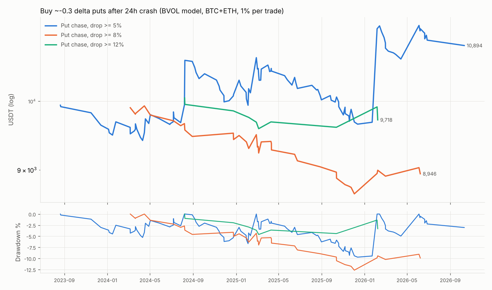

# 期权实验报告:彩票期权 & 暴跌后追买看跌

> 纯历史数据模拟:未连接任何账户、未下任何真实订单、不需要 API 密钥。
> 生成时间 2026-10-20 10:10 UTC

## 1. 数据和最重要的局限

| 数据 | 来源 | 时间范围 | 用途 |
|---|---|---|---|
| 期权逐小时真实快照(买一/卖一/标记价/IV/Delta) | 币安 data.binance.vision `EOHSummary` | **2023-05-18 ~ 2023-10-23**(BTC/ETH 147 天,BNB/XRP/DOGE 更少) | “真实”结果 |
| BVOL 指数(币安 BTC/ETH 30 天隐含波动率,逐秒→每小时) | 币安 `BVOLIndex` | 2023-06-20 ~ 2026-10-20 | 模型定价 |
| 现货 1 小时 K 线 | 币安 | 2023-01 起 | 结算价、4 小时信号 |

- **币安公开的期权逐笔/快照数据只有 2023 年 5–10 月这 5 个月**(一段低波动的平静期)。更长的真实期权历史需要
  Deribit 等数据源,但本运行环境的网络策略禁止访问 `history.deribit.com` / `www.deribit.com`(也禁止 Tardis、OKX、Bybit、
  币安期权 API)。可以在云环境设置的 Network access 里把这些域名加入允许列表后重跑,见
  [文档](https://code.claude.com/docs/en/cloud-environments#network-access)。
- 因此本报告分两部分:**真实快照结果**(样本小但是真实成交价)和 **BVOL 模型估算**(2023-06 起 3 年多):
  用真实的 BVOL 隐含波动率 × 用 2023 年真实快照校准的“偏斜系数”,按 Black–Scholes 定价,
  买卖价按校准的卖一/买一系数。**模型结果不是真实成交**,它假设 2023 年那段时间测到的
  “翼部 IV 比 BVOL 高多少”“价差多大”在之后几年保持不变。
- 手续费:币安期权交易费 0.03% × 标的价格 × 数量、行权费 0.015%。网上资料没有确认币安是否对手续费设“不超过权利金 10%”的上限,
  所以两种都跑:**封顶(默认)** 和 **不封顶**。对几美元的深度虚值期权,这个差别非常大。

## 2. 规则(在看结果之前定死)

**A. 彩票期权**
- 每个到期日(币安每天 08:00 UTC 到期),在到期前 24 小时的快照里,分别找虚值看涨和虚值看跌中 |Delta| 在 0.02–0.05、
  有卖一价的合约,选**卖一价最便宜**的那一档;按卖一价买入。
- 每张“彩票”(看涨、看跌各算一张)花当时账户的 0.2%(含手续费)。
- 持有期间每小时检查:买一价 ≥ 成本价 × 10 → 按买一价卖一半;其余持有到期,按结算价(到期时刻的现货价)行权。
- “中奖”= 到期时有内在价值;“归零”= 到期没有价值且没卖出过一半。R = 净收回 ÷ 成本 − 1(最多 −1R)。
- 模型版本:每天 08:00 到期;行权价按校准的间距排列,选 |Delta| ≥ 0.02 的最远一档(即最便宜的一档)。

**B. 暴跌后追买看跌**
- 信号:4 小时 K 线收盘价比 24 小时前(6 根)跌 ≥ 5% / 8% / 12%,且收盘价 < 4h MA20;只在条件“刚出现”那根触发。
- 买入:至少 48 小时后最近的周五 08:00 到期、Delta 最接近 −0.30 的看跌,按卖一价,花账户 1%(含手续费)。
- 平仓:买一价 ≥ 成本 × 2 → 卖一半;剩余在 4h 收盘站回 MA20 后、或到期前 24 小时按买一价全部卖出;卖不掉则到期结算。
- 同一标的同时只持有一笔。“平时 IV”= 开仓前 30 天 BVOL 的中位数。
- 马丁对照:每次亏损后下一笔权利金加倍,盈利后回到账户 1%;权益跌破初始的 1% 视为归零。

## 3. 实验 A:彩票期权

### 3.1 用真实快照校准(BVOL 与真实快照重叠的 2023-06-20 ~ 2023-10-23)

| 标的 | 彩票·看涨 IV÷BVOL | 彩票·看跌 IV÷BVOL | 彩票·卖一÷标记 | 彩票·买一÷标记 | Δ−0.3 看跌 IV÷BVOL | 看跌·卖一÷标记 | 看跌·买一÷标记 | 行权价间距 | 最小报价 | 校准样本(彩票/看跌) |
|---|---|---|---|---|---|---|---|---|---|---|
| BTCUSDT | 1.41 | 1.37 | 1.32 | 0.71 | 0.81 | 1.03 | 0.98 | 1.7% | 5 | 87/1724 |
| ETHUSDT | 1.31 | 1.44 | 1.31 | 1.00 | 0.83 | 1.04 | 0.97 | 1.6% | 0.1 | 81/1637 |

- 深度虚值翼部的隐含波动率约为 BVOL 的 **1.3–1.4 倍**(波动率微笑),买入时的卖一价又比标记价高约 **30%**。

模型 vs 真实(同一段时间):

| 标的 | 数据 | 笔数 | 中奖率 | 期望值(R) | 到期价值÷卖一价 |
|---|---|---|---|---|---|
| BTCUSDT | 真实快照 | 87 | 1.15% | -0.599 | 0.551 |
| BTCUSDT | BVOL 模型 | 182 | 1.10% | -0.727 | 0.408 |
| ETHUSDT | 真实快照 | 81 | 1.23% | -0.474 | 0.147 |
| ETHUSDT | BVOL 模型 | 219 | 0.91% | -0.873 | 0.121 |

### 3.2 真实快照结果(2023-05-18 ~ 2023-10-23)

| 标的 | 笔数 | 中奖率(到期有价值) | ≥10倍 | ≥40倍 | 最大倍数 | 期望值(R)·费率封顶 | 期望值(R)·不封顶 | 最长连续归零 | 到期价值÷卖一价 | 到期价值÷标记价 [95%区间] | 卖一÷标记价 |
|---|---|---|---|---|---|---|---|---|---|---|---|
| BTCUSDT | 129 | 0.78% | 1 笔 (0.78%) | 0 笔 (0.00%) | 34.9× | -0.729 | -0.840 | 95 | 0.357 | 0.41 [0.00, 1.28] | 1.43 |
| ETHUSDT | 121 | 0.83% | 1 笔 (0.83%) | 0 笔 (0.00%) | 37.7× | -0.607 | -0.731 | 48 | 0.090 | 0.12 [0.00, 0.38] | 1.33 |
| BNBUSDT | 84 | 1.19% | 0 笔 (0.00%) | 0 笔 (0.00%) | 0.2× | -0.998 | -0.999 | 71 | 0.003 | 0.01 [0.00, 0.02] | 1.00 |
| XRPUSDT | 21 | 4.76% | 0 笔 (0.00%) | 0 笔 (0.00%) | 7.9× | -0.625 | -0.625 | 12 | 0.134 | 0.21 [0.00, 0.68] | 1.67 |
| DOGEUSDT | 7 | 0.00% | 0 笔 (0.00%) | 0 笔 (0.00%) | 0.0× | -1.000 | -1.000 | 7 | 0.000 | 0.00 [0.00, 0.00] | 1.84 |
| BTC+ETH | 250 | 0.80% | 2 笔 (0.80%) | 0 笔 (0.00%) | 37.7× | -0.670 | -0.787 | 102 | 0.341 | 0.40 [0.00, 1.24] | 1.33 |
| 全部 5 个 | 362 | 1.10% | 2 笔 (0.55%) | 0 笔 (0.00%) | 37.7× | -0.750 | -0.831 | 125 | 0.334 | 0.39 [0.00, 1.32] | 1.33 |

|  | 笔数 | 中奖率(到期有价值) | ≥10倍 | ≥40倍 | 最大倍数 | 期望值(R)·费率封顶 | 期望值(R)·不封顶 | 最长连续归零 | 到期价值÷卖一价 | 到期价值÷标记价 [95%区间] | 卖一÷标记价 |
|---|---|---|---|---|---|---|---|---|---|---|---|
| BTC+ETH · 看涨 | 123 | 0.00% | 0 笔 (0.00%) | 0 笔 (0.00%) | 5.0× | -0.960 | — | 102 | 0.000 | 0.00 [0.00, 0.00] | 1.33 |
| BTC+ETH · 看跌 | 127 | 1.57% | 2 笔 (1.57%) | 0 笔 (0.00%) | 37.7× | -0.390 | — | 82 | 0.620 | 0.74 [0.00, 2.52] | 1.33 |

- “到期价值 ÷ 标记价”< 1 说明即使按中间价买也是亏的(期权被高估);< 1 的程度越大越高估。
  方括号是 bootstrap 95% 区间——中奖的只有极少几笔,所以区间很宽。

### 3.3 BVOL 模型(2023-06 ~ 至今,BTC + ETH)

|  | 笔数 | 中奖率(到期有价值) | ≥10倍 | ≥40倍 | 最大倍数 | 期望值(R)·费率封顶 | 期望值(R)·不封顶 | 最长连续归零 | 到期价值÷卖一价 | 到期价值÷标记价 [95%区间] | 卖一÷标记价 |
|---|---|---|---|---|---|---|---|---|---|---|---|
| BTC+ETH 全部 | 4109 | 0.88% | 35 笔 (0.85%) | 11 笔 (0.27%) | 140.7× | -0.666 | -0.757 | 335 | 0.296 | 0.41 [0.21, 0.64] | 1.36 |
| BTCUSDT · 看涨 | 990 | 0.61% | 6 笔 (0.61%) | 2 笔 (0.20%) | 57.5× | -0.791 | -0.866 | 499 | 0.159 | 0.22 [0.05, 0.44] | 1.39 |
| BTCUSDT · 看跌 | 879 | 1.25% | 10 笔 (1.14%) | 2 笔 (0.23%) | 50.6× | -0.695 | -0.773 | 154 | 0.439 | 0.61 [0.24, 1.07] | 1.39 |
| ETHUSDT · 看涨 | 1137 | 0.70% | 9 笔 (0.79%) | 3 笔 (0.26%) | 140.7× | -0.557 | -0.682 | 100 | 0.376 | 0.51 [0.06, 1.11] | 1.34 |
| ETHUSDT · 看跌 | 1103 | 1.00% | 10 笔 (0.91%) | 4 笔 (0.36%) | 66.5× | -0.642 | -0.724 | 259 | 0.374 | 0.50 [0.14, 0.95] | 1.34 |
| 2023 | 643 | 0.78% | 4 笔 (0.62%) | 0 笔 (0.00%) | 31.4× | -0.849 | -0.885 | 164 | 0.193 | 0.28 [0.00, 0.77] | 1.40 |
| 2024 | 1366 | 0.81% | 10 笔 (0.73%) | 3 笔 (0.22%) | 98.8× | -0.729 | -0.795 | 269 | 0.222 | 0.31 [0.06, 0.68] | 1.35 |
| 2025 | 1159 | 1.04% | 13 笔 (1.12%) | 5 笔 (0.43%) | 85.5× | -0.600 | -0.697 | 335 | 0.326 | 0.45 [0.09, 0.92] | 1.34 |
| 2026 | 941 | 0.85% | 8 笔 (0.85%) | 3 笔 (0.32%) | 140.7× | -0.530 | -0.689 | 186 | 0.422 | 0.59 [0.13, 1.16] | 1.37 |

资金曲线(初始 10,000 USDT,每张 0.2%):BVOL 模型 2023-06 → 2026-10 期末
**35 USDT**(最大回撤 -99.7%);手续费不封顶时 18 USDT;
真实快照 5 个月期末 7,080 USDT(最大回撤 -28.6%)。

**敏感性:翼部定价假设**。上面的“高估”结论部分来自校准出的“翼部 IV ≈ BVOL × 1.4”。
如果翼部只按 BVOL × 1.0 或 × 1.2 定价(即期权比实际便宜),结果如下:

| 翼部 IV 假设 | 笔数 | 中奖率 | 到期价值÷标记价 [95%区间] | 期望值(R) |
|---|---|---|---|---|
| BVOL × 1 | 3304 | 2.06% | 1.14 [0.65, 1.74] | -0.194 |
| BVOL × 1.2 | 3789 | 1.40% | 0.65 [0.36, 0.98] | -0.499 |
| BVOL × 校准值(≈1.4) | 4109 | 0.88% | 0.41 [0.21, 0.63] | -0.666 |

翼部按 BVOL × 1.0 定价时,到期价值 ÷ 标记价为 1.14(区间 0.65–1.74),区间包含 1:按平值 IV 定价时大致是公平的。也就是说,**高估主要来自波动率微笑**——市场对深度虚值期权多收了约 40% 的隐含波动率,而这段时间实际发生的 24 小时尾部波动并不支持这个溢价;再加上卖一价比标记价高约 30% 和手续费,即使在 × 1.0 的假设下,买方每笔期望仍是 -0.194R。

## 4. 实验 B:暴跌后追买看跌

### 4.1 真实快照(2023-05 ~ 10,5 个标的)

| 阈值 | 笔数 | 胜率 | 期望值(R) | R 中位数 | 翻倍卖一半 | 最好一笔 | 反弹(收复MA20)离场的亏损·笔数占比 | ·亏损金额占比 | 开仓 BVOL ÷ 前30天中位数 | BVOL 高出(百分点) | 平均持有(小时) | 最长连亏 | 期权 IV ÷ 平时同类 IV |
|---|---|---|---|---|---|---|---|---|---|---|---|---|---|
| 5% | 12 | 8.3% | -0.658 | -0.75 | 0.0% | +0.10R | 100.0% | 100.0% | 1.31× | 12.1 | 55 | 6.0 | 1.30× |
| 8% | 1 | 0.0% | -0.731 | -0.73 | 0.0% | -0.73R | 100.0% | 100.0% | — | — | 72 | 1.0 | 1.97× |
| 12% | 0 | — | — | — | — | — | — | — | — | — | — | — | — |

这段时间几乎没有暴跌,样本只有个位数,仅作参考。

### 4.2 BVOL 模型(2023-07 ~ 至今,BTC + ETH)

| 阈值 | 笔数 | 胜率 | 期望值(R) | R 中位数 | 翻倍卖一半 | 最好一笔 | 反弹(收复MA20)离场的亏损·笔数占比 | ·亏损金额占比 | 开仓 BVOL ÷ 前30天中位数 | BVOL 高出(百分点) | 平均持有(小时) | 最长连亏 |
|---|---|---|---|---|---|---|---|---|---|---|---|---|
| 5% | 121 | 38.8% | 0.090 | -0.46 | 37.2% | +9.16R | 90.5% | 90.7% | 1.04× | 2.3 | 54 | 8 |
| 8% | 41 | 34.1% | -0.266 | -0.76 | 34.1% | +3.18R | 77.8% | 76.9% | 1.09× | 5.3 | 50 | 9 |
| 12% | 11 | 27.3% | -0.251 | -0.98 | 27.3% | +3.18R | 75.0% | 77.1% | 1.23× | 12.8 | 59 | 4 |

阈值 8% 的分年份:

| 年份 | 笔数 | 胜率 | 期望值(R) | R 中位数 | 翻倍卖一半 | 最好一笔 | 反弹(收复MA20)离场的亏损·笔数占比 | ·亏损金额占比 | 开仓 BVOL ÷ 前30天中位数 | BVOL 高出(百分点) | 平均持有(小时) | 最长连亏 |
|---|---|---|---|---|---|---|---|---|---|---|---|---|
| 2024 | 13 | 30.8% | -0.449 | -0.76 | 30.8% | +1.20R | 55.6% | 57.6% | 1.03× | 1.8 | 50 | 4 |
| 2025 | 22 | 27.3% | -0.374 | -0.87 | 27.3% | +2.14R | 87.5% | 85.2% | 1.08× | 4.9 | 51 | 9 |
| 2026 | 6 | 66.7% | 0.526 | 0.25 | 66.7% | +3.18R | 100.0% | 100.0% | 1.28× | 14.5 | 47 | 1 |

资金曲线期末(初始 10,000 USDT,每笔 1%):5% 阈值 10,894 USDT(最大回撤 -9.7%)、8% 阈值 8,946 USDT(最大回撤 -12.6%)、12% 阈值 9,718 USDT(最大回撤 -4.6%)。

- “开仓 BVOL ÷ 前 30 天中位数”:开仓时 30 天隐含波动率比平时高多少。跌得越狠越贵——12% 阈值时已是**涨价后的保险**;
  而真实快照里实际买入的短期限看跌,其 IV 比平时同类期权高得更多(见 4.1 最后一列)。
- 注意模型的偏差方向:暴跌时短期限看跌的偏斜会变陡,而模型用的是平静期校准的固定系数,
  **会低估开仓时的权利金**,所以模型结果对买方是偏乐观的。

### 4.3 马丁对照(8% 阈值的交易序列)

- 真实顺序跑一遍:**31 笔后归零**(共 41 笔),
  单笔下注最高达到当时账户的 100%。
- 按历史 R 分布有放回抽样 5000 条路径(每条 183 笔 ≈ 10 年,按每年约 18 笔换算天数):

| | 马丁(亏损后加倍) | 固定 1% |
|---|---|---|
| 10 年内归零的概率 | **94.7%** | 0.0% |
| 归零所需时间:中位数 | 880 天(44 笔) | — |
| 归零所需时间:平均 | 1127 天 | — |
| 1 年内归零 | 18.9% | — |

有放回抽样假设每笔独立;真实的暴跌往往扎堆出现(连续几笔都亏),所以真实的归零速度只会更快。

## 5. 结论

**彩票期权在币圈平均是被高估的。** BVOL 模型(2023-06 至今,BTC+ETH,4109 张):到期价值只有标记价的 0.41 倍(95% 区间 0.21–0.63,区间整体 < 1),按实际要付的卖一价只有 0.296 倍;中奖率 0.88%,≥10 倍 35 笔 (0.85%)、≥40 倍 11 笔 (0.27%),每笔期望值 -0.666R(手续费不封顶 -0.757R),最长连续归零 335 张。真实快照(2023 年 5–10 月,250 张)方向一致:到期价值 ÷ 标记价 0.40,但只有 2 张中奖,区间 0.00–1.31 跨过 1,单看真实样本不能下定论。高估从哪来:如果翼部按平值隐含波动率定价(BVOL × 1),到期价值 ÷ 标记价为 1.14 [0.65, 1.74]——大致公平;实际市场给深度虚值期权的 IV 约为 BVOL 的 1.3–1.4 倍(波动率微笑),这部分溢价没有被实际发生的尾部行情兑现。再叠加卖一价比标记价高约 30%、按标的名义价值收的手续费,买方每笔亏掉大半权利金;偶尔的几十倍、上百倍不足以弥补几乎每天的归零。

**暴跌后追买看跌:只有 5% 阈值在模型里略为正,而且不可靠。** 模型(BTC+ETH):5% 阈值 121 笔 0.090R(中位数 -0.46R)、8% 阈值 41 笔 -0.266R(中位数 -0.76R)、12% 阈值 11 笔 -0.251R(中位数 -0.98R)。5% 的正值来自少数几笔(最好一笔 +9.16R),中位数仍是亏损;同一阈值在真实快照里 12 笔、-0.658R;而且模型对暴跌时的看跌权利金偏低估(见下),所以不能当作正期望。开仓时 BVOL 是平时的 1.04×/1.09×/1.23×(5%/8%/12%),跌得越狠、隐含波动率越贵;真实快照里所买期权自身的 IV 是平时同类期权的 1.30×(5%)——短期限看跌比 30 天指数涨得更多,模型低估了这一点。8% 阈值下亏损交易中 77.8% 是“暴跌后反弹站回 MA20”离场,占亏损金额的 76.9%:暴跌后买看跌,最常见的结局是价格反弹 + 隐含波动率回落,两头亏。

**马丁会把一个负期望的策略变成必然归零。** 按 8% 阈值的历史 R 分布抽样,马丁加倍在 10 年内归零的概率 94.7%(固定 1% 为 0.0%),归零时间中位数约 880 天、平均 1127 天,18.9% 的路径在 1 年内归零;按真实顺序跑,31 笔后就归零了。加倍不改变期望值,只是把小额、分散的亏损变成一次性的全部亏损。

**数据局限**:真实期权快照只有 2023 年 5–10 月;3 年多的结果依赖 BVOL + 校准系数的模型,模型对暴跌时的看跌权利金偏低估(对买方偏乐观)。开放 Deribit 数据访问后可以用真实历史成交重做。
