# “抛物线做空”策略 · 币安 USDT 永续回测报告

> 纯历史数据模拟:未连接任何账户、未下任何真实订单、不需要 API 密钥。
> 生成时间 2026-10-20 09:53 UTC · 数据截至 2026-10-19

## 1. 数据

- 做空在现货上做不了,所以这里用**币安 USDT 本位永续合约**的公开历史数据(data.binance.vision):
  日线 + 4 小时线(只为出现暴涨的合约下载)+ **真实历史资金费率**。共 **695** 个合约,
  其中 30 个在回测结束前已下架(数据仍保留,持仓期间下架按最后收盘价平仓)。
- 这意味着:**只有当时已经上线永续合约的币才能被做空**。很多只在现货暴涨、没有合约的小币,散户本来就空不了,所以不在样本里。
- 日线按 UTC 00:00 切分;流动性 = 近 7 天合约日均成交额 ≥ 500 万 USDT。
- 选中变体的交易里,**98%** 的资金费结算点用的是真实历史费率,其余按“空头每 8 小时付 0.1%”保守估计。

## 2. 规则(看结果之前定死)

| 环节 | 规则 | 参数 |
|---|---|---|
| 暴涨 | 收盘时过去 3 或 4 天累计涨幅 ≥ 100% / 200% / 300%;第一次满足的这天 = 暴涨第 1 天(D);10 天内不重复计 | `pump_threshold`, `pump_windows`, `max_wait_days` |
| 不追第 1、2 天 | 最早在 D+2(第 3 天)开仓,最晚 D+10;每个事件最多一笔 | `min_entry_offset` |
| 入场 A(日线) | s 日收盘价 < s−1 日最低价(s ≥ D+1)→ s+1 日开盘做空 | `entry_mode="daily"` |
| 入场 B(4h) | 当天首根 4h K 线(00–04 UTC)的最低点被之后的 4h K 线跌破 → 在该价位做空(低开则按开盘价) | `entry_mode="4h"` |
| 止损 | 当天最高点(日线入场 = 信号日最高;4h 入场 = 当天截至触发的最高)或 成交价 + 1×ATR(14);止损距离 > 1.5×ATR 则放弃 | `stop_mode`, `max_stop_atr` |
| 止损成交价 | max(止损价, 下一根 K 线开盘价);当根直接跳空到止损上方则按开盘价——模拟急涨跳空。持仓期间用 **4h K 线**检查(“下一根”= 下一根 4h);第 5 节另给出只用日线(“下一根”= 次日开盘)的更保守结果 | `intraday_bars` |
| 仓位 | 风险 0.5%;数量 = 账户 × 0.5% ÷ 止损距离;单笔名义 ≤ 25% 账户;全部空单名义 ≤ 100% 账户 | `risk_per_trade`, `max_position_pct`, `max_gross_exposure` |
| 平一半 | 最低价 ≤ 前一日 MA10 × 1.02(“均线附近”)→ 按该价平一半,剩余止损移到开仓价 | `ma_touch_buffer`, `partial_frac` |
| 全平 | 平一半之后收盘价 > MA10 → 次日开盘全平;最长持有 20 天(第 20 天收盘全平) | `max_hold_days` |
| 成本 | 手续费每次开/平 0.05% / 0.1% / 0.6% 三档;滑点每次 0.2%;真实资金费率(缺失时空头每 8h 付 0.1%) | `fee`, `slippage`, `funding_mode` |

同一天内的先后顺序一律按对空头**最不利**处理:先检查止损,再检查平一半。
**R** = 本笔净盈亏(价格 + 手续费 + 滑点 + 资金费)÷ 开仓时计划风险。

**选参方式(预先定死)**:12 个变体(3 档阈值 × 2 种入场 × 2 种止损)全部跑;只用 **2020–2023** 在手续费 0.1% 下
按“每笔期望值(R)”挑一个(样本内 ≥ 20 笔);**2024-01-01 至今只用来检验**,所有参数不再改动。
三档手续费、资金费假设都只是成本情景,不参与挑选。

**透明说明(唯一一次看过试跑结果后的改动)**:最初持仓期间只用日线检查止损(“下一根 K 线”= 次日开盘)。
试跑一个变体时发现 ALPACA 的 −26R 来自“次日开盘”恰好是下架结算后冻结的价格,不是真实可成交价,
所以改为有 4h 数据时用 4h K 线检查止损(“下一根”= 下一根 4h),并把下架结算后的零成交 K 线视为已停止交易。
这是成交真实性的修正,不是调参;改动前的日线版本结果放在第 5 节作为压力测试(结果更差),不影响结论方向。

## 3. 暴涨事件有多少

| 阈值 | 事件数 | 涉及合约 | 2020 | 2021 | 2022 | 2023 | 2024 | 2025 | 2026 |
|---|---|---|---|---|---|---|---|---|---|
| ≥100% | 480 | 302 | 5 | 60 | 14 | 19 | 38 | 156 | 188 |
| ≥200% | 120 | 105 | 0 | 8 | 3 | 2 | 1 | 46 | 60 |
| ≥300% | 46 | 41 | 0 | 3 | 1 | 0 | 0 | 20 | 22 |

## 4. 12 个变体:样本内 vs 样本外(手续费 0.1%)

★ = 按预定规则在样本内选中的变体:**100% · 日线收盘破前低 · 1×ATR 止损**

| 变体 | 内·笔数 | 内·胜率 | 内·期望R | 内·最大回撤 | 外·笔数 | 外·胜率 | 外·期望R | 外·最大回撤 | 外·最差单笔 |
|---|---|---|---|---|---|---|---|---|---|
| 100% · 日线收盘破前低 · 当天最高止损 | 83 | 45.8% | -0.139 | -6.9% | 303 | 34.3% | -0.131 | -18.2% | -3.73R |
| 100% · 日线收盘破前低 · 1×ATR 止损 ★ | 84 | 56.0% | -0.060 | -4.3% | 333 | 36.3% | -0.165 | -24.5% | -3.65R |
| 100% · 4h 破首根低点 · 当天最高止损 | 97 | 39.2% | -0.210 | -12.6% | 371 | 40.4% | -0.169 | -32.9% | -8.40R |
| 100% · 4h 破首根低点 · 1×ATR 止损 | 97 | 44.3% | -0.226 | -11.5% | 373 | 44.5% | -0.162 | -30.4% | -6.73R |
| 200% · 日线收盘破前低 · 当天最高止损 | 10 | 50.0% | -0.191 | -1.2% | 86 | 31.4% | -0.100 | -4.4% | -2.22R |
| 200% · 日线收盘破前低 · 1×ATR 止损 | 11 | 54.5% | -0.099 | -1.1% | 91 | 30.8% | -0.257 | -11.1% | -3.65R |
| 200% · 4h 破首根低点 · 当天最高止损 | 12 | 33.3% | -0.322 | -3.0% | 103 | 35.9% | -0.278 | -17.2% | -8.40R |
| 200% · 4h 破首根低点 · 1×ATR 止损 | 12 | 41.7% | -0.152 | -2.4% | 104 | 40.4% | -0.137 | -10.6% | -4.18R |
| 300% · 日线收盘破前低 · 当天最高止损 | 4 | 50.0% | -0.328 | -0.8% | 33 | 33.3% | -0.055 | -1.8% | -1.29R |
| 300% · 日线收盘破前低 · 1×ATR 止损 | 4 | 50.0% | -0.338 | -0.7% | 35 | 28.6% | -0.250 | -4.9% | -2.16R |
| 300% · 4h 破首根低点 · 当天最高止损 | 4 | 50.0% | -0.205 | -0.8% | 39 | 41.0% | -0.140 | -6.6% | -8.40R |
| 300% · 4h 破首根低点 · 1×ATR 止损 | 4 | 50.0% | -0.492 | -1.1% | 39 | 41.0% | -0.099 | -4.8% | -4.18R |

样本内期望为正的变体 0/12 个;样本外 0/12 个
(手续费 0.6% 时样本外 0/12 个)。

### 手续费敏感性(每笔期望值 R;内 = 2020–23,外 = 2024–)

| 变体 | 0.05%(币安合约吃单)·内 | 0.05%(币安合约吃单)·外 | 0.1%·内 | 0.1%·外 | 0.6%(Coinbase 档)·内 | 0.6%(Coinbase 档)·外 |
|---|---|---|---|---|---|---|
| 100% · 日线收盘破前低 · 当天最高止损 | -0.132 | -0.125 | -0.139 | -0.131 | -0.212 | -0.190 |
| 100% · 日线收盘破前低 · 1×ATR 止损 | -0.055 | -0.161 | -0.060 | -0.165 | -0.112 | -0.209 |
| 100% · 4h 破首根低点 · 当天最高止损 | -0.200 | -0.160 | -0.210 | -0.169 | -0.310 | -0.260 |
| 100% · 4h 破首根低点 · 1×ATR 止损 | -0.219 | -0.155 | -0.226 | -0.162 | -0.295 | -0.223 |
| 200% · 日线收盘破前低 · 当天最高止损 | -0.185 | -0.095 | -0.191 | -0.100 | -0.255 | -0.148 |
| 200% · 日线收盘破前低 · 1×ATR 止损 | -0.095 | -0.254 | -0.099 | -0.257 | -0.141 | -0.288 |
| 200% · 4h 破首根低点 · 当天最高止损 | -0.315 | -0.271 | -0.322 | -0.278 | -0.395 | -0.351 |
| 200% · 4h 破首根低点 · 1×ATR 止损 | -0.147 | -0.131 | -0.152 | -0.137 | -0.206 | -0.190 |
| 300% · 日线收盘破前低 · 当天最高止损 | -0.322 | -0.050 | -0.328 | -0.055 | -0.395 | -0.098 |
| 300% · 日线收盘破前低 · 1×ATR 止损 | -0.334 | -0.247 | -0.338 | -0.250 | -0.370 | -0.279 |
| 300% · 4h 破首根低点 · 当天最高止损 | -0.199 | -0.133 | -0.205 | -0.140 | -0.264 | -0.207 |
| 300% · 4h 破首根低点 · 1×ATR 止损 | -0.488 | -0.094 | -0.492 | -0.099 | -0.535 | -0.151 |

## 5. 选中变体详细结果:100% · 日线收盘破前低 · 1×ATR 止损

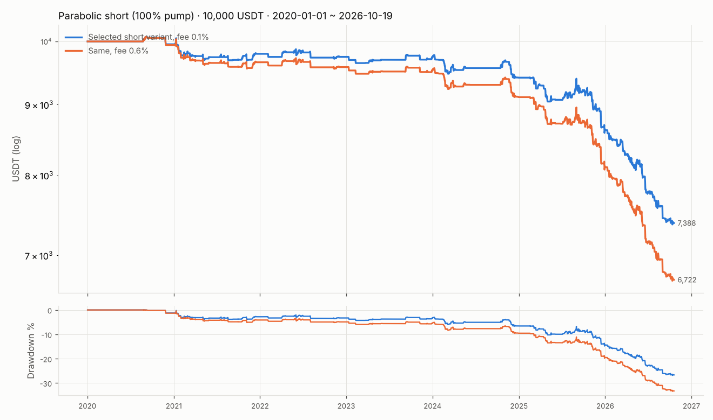

|  | 交易数 | 胜率 | 盈亏比 | 期望值(R) | 累计R | 总收益 | 最大回撤 | 最长连亏 | 单笔最大亏损 | < −2R 笔数 | 夏普 | 平均资金费(R) |
|---|---|---|---|---|---|---|---|---|---|---|---|---|
| 样本内 2020–2023 | 84 | 56.0% | 0.60 | -0.060 | -5.0 | -2.5% | -4.3% | 4 | -1.71R | 0 | -0.36 | 0.006 |
| 样本外 2024–至今 | 333 | 36.3% | 0.84 | -0.165 | -55.1 | -24.3% | -24.5% | 14 | -3.65R | 7 | -2.22 | -0.009 |
| 全区间 | 417 | 40.3% | 0.78 | -0.144 | -59.9 | -26.1% | -26.9% | 14 | -3.65R | 7 | -1.40 | -0.006 |
| 样本内 · 手续费 0.05%(币安合约吃单) | 84 | 56.0% | 0.61 | -0.055 | -4.6 | -2.3% | -4.1% | 4 | -1.70R | 0 | -0.33 | 0.006 |
| 样本外 · 手续费 0.05%(币安合约吃单) | 333 | 37.5% | 0.81 | -0.161 | -53.6 | -23.7% | -23.9% | 14 | -3.64R | 7 | -2.17 | -0.009 |
| 样本内 · 手续费 0.6%(Coinbase 档) | 84 | 42.9% | 0.79 | -0.112 | -9.4 | -4.6% | -5.9% | 7 | -1.79R | 0 | -0.65 | 0.006 |
| 样本外 · 手续费 0.6%(Coinbase 档) | 333 | 31.8% | 0.85 | -0.209 | -69.5 | -29.6% | -29.7% | 14 | -3.70R | 9 | -2.76 | -0.009 |
| 样本内 · 资金费全按 −0.1%/8h | 84 | 50.0% | 0.63 | -0.095 | -8.0 | -4.0% | -5.5% | 5 | -1.77R | 0 | -0.57 | -0.029 |
| 样本外 · 资金费全按 −0.1%/8h | 333 | 36.0% | 0.79 | -0.178 | -59.3 | -25.9% | -26.0% | 14 | -3.67R | 7 | -2.40 | -0.022 |
| 样本内 · 止损只用日线(次日开盘成交) | 84 | 50.0% | 0.54 | -0.161 | -13.5 | -6.6% | -7.7% | 5 | -1.87R | 0 | -0.79 | 0.009 |
| 样本外 · 止损只用日线(次日开盘成交) | 333 | 36.9% | 0.75 | -0.243 | -81.0 | -33.6% | -34.1% | 13 | -4.71R | 11 | -2.49 | -0.014 |

- 信号漏斗(全区间):暴涨事件 479 → 出现走弱信号 417 → 开盘已高于止损放弃 0
  · 止损距离 > 1.5ATR 放弃 0 · 缺 4h 数据 0 · 总敞口已满 0 → 成交 **417** 笔
- 离场原因:breakeven_stop 268, stop 93, ma_exit 51, max_hold 4, delisted 1
- 最大回撤 -26.9%:2020-09-03 → 2026-10-12
  (下跌 2230 天),至今未收复;
  最长水下期 2236 天
- **单笔最大亏损 -3.65R**;亏损超过 1.5R 的 19 笔、超过 2R 的 7 笔、超过 3R 的 1 笔
  (止损按“止损价和下一根开盘价中更差的”成交,所以急涨跳空时亏损会远超 1R)

### 蒙特卡洛:打乱交易顺序 1000 次

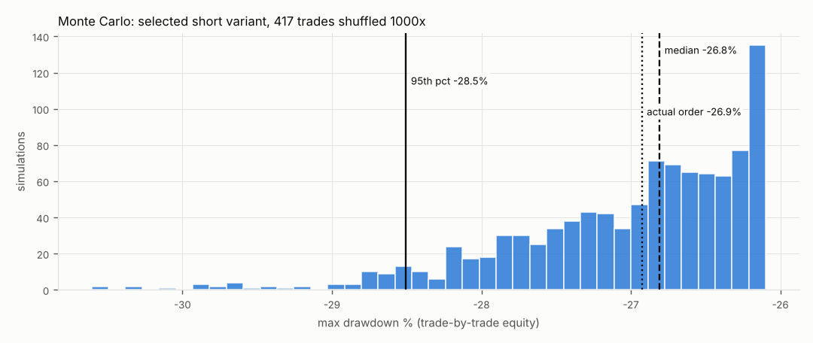

| | 实际顺序 | 中位数 | 95% 分位 | 99% 分位 | 1000 次中最差 |
|---|---|---|---|---|---|
| 最大回撤(逐笔复利,风险 0.5%) | -26.9% | -26.8% | -28.5% | -29.6% | -30.6% |
| 最大回撤(R) | -62.2R | -61.9R | -66.6R | -69.8R | — |
| 最长连亏(笔) | 14 | 10 | 15 | 18 | — |

**注意:这里每笔期望为负,回撤主要由“持续亏损”决定,打乱顺序几乎不改变最大回撤(分布很窄)——说明问题不是运气差,而是没有优势。下面的刹车线只在策略本身有正期望时才有意义。**

刹车线参考:回撤到中位数(-26.8%)减半风险;到 95% 分位(-28.5%,约 -67R)停止开新仓并复查。
蒙特卡洛只打乱了**已有**交易的顺序,无法覆盖“比历史上更极端的一次轧空”,做空策略的真实尾部比这里更厚。

## 6. 最好和最差的 10 笔(选中变体,全区间)

### 最好的 10 笔

| symbol | 暴涨幅度 | 暴涨第1天 | entry_date | exit_date | entry_price | 止损距离 | hold_days | 资金费(R) | R | exit_reason |
|---|---|---|---|---|---|---|---|---|---|---|
| ICPUSDT | +109% | 2025-11-07 | 2025-11-10 | 2025-11-29 | 7.53989 | 15.5% | 20 | +0.01 | +2.06 | max_hold |
| GTCUSDT | +201% | 2021-11-26 | 2021-11-29 | 2021-12-18 | 18.7325 | 16.0% | 20 | +0.02 | +1.99 | ma_exit |
| XPLUSDT | +139% | 2025-09-27 | 2025-09-30 | 2025-10-19 | 1.1964 | 19.4% | 20 | +0.01 | +1.94 | max_hold |
| BICOUSDT | +132% | 2026-08-05 | 2026-08-10 | 2026-08-26 | 0.048403 | 21.9% | 17 | -0.10 | +1.76 | ma_exit |
| APEUSDT | +110% | 2024-10-20 | 2024-10-23 | 2024-11-07 | 1.35119 | 11.9% | 16 | +0.01 | +1.73 | ma_exit |
| CVXUSDT | +104% | 2025-07-24 | 2025-07-29 | 2025-07-31 | 5.31335 | 8.6% | 3 | +0.01 | +1.66 | ma_exit |
| BAKEUSDT | +128% | 2022-03-31 | 2022-04-03 | 2022-04-22 | 1.1987 | 13.5% | 20 | +0.02 | +1.56 | ma_exit |
| FRONTUSDT | +106% | 2024-03-14 | 2024-03-19 | 2024-03-29 | 1.92684 | 17.4% | 11 | +0.01 | +1.54 | ma_exit |
| RIVERUSDT | +124% | 2026-01-21 | 2026-01-28 | 2026-02-11 | 62.9948 | 28.3% | 15 | -0.09 | +1.52 | ma_exit |
| IDOLUSDT | +102% | 2025-09-03 | 2025-09-07 | 2025-09-10 | 0.0352194 | 13.1% | 4 | +0.01 | +1.38 | ma_exit |

### 最差的 10 笔

| symbol | 暴涨幅度 | 暴涨第1天 | entry_date | exit_date | entry_price | 止损距离 | hold_days | 资金费(R) | R | exit_reason |
|---|---|---|---|---|---|---|---|---|---|---|
| FHEUSDT | +150% | 2025-12-07 | 2025-12-13 | 2025-12-14 | 0.0411475 | 26.9% | 2 | +0.00 | -3.65 | stop |
| TAUSDT | +189% | 2025-08-29 | 2025-09-01 | 2025-09-02 | 0.12498 | 15.1% | 2 | +0.01 | -2.66 | stop |
| GUAUSDT | +105% | 2026-06-18 | 2026-06-20 | 2026-06-20 | 0.893509 | 23.0% | 1 | -0.00 | -2.29 | stop |
| RAREUSDT | +116% | 2025-03-11 | 2025-03-14 | 2025-03-14 | 0.0861074 | 18.4% | 1 | -0.07 | -2.28 | stop |
| BTRUSDT | +378% | 2026-08-26 | 2026-09-01 | 2026-09-01 | 0.0951393 | 34.7% | 1 | +0.00 | -2.16 | stop |
| BLESSUSDT | +153% | 2026-08-02 | 2026-08-05 | 2026-08-05 | 0.0108552 | 29.0% | 1 | +0.00 | -2.04 | stop |
| ALCHUSDT | +158% | 2025-02-26 | 2025-03-05 | 2025-03-06 | 0.0437423 | 30.0% | 2 | +0.01 | -2.03 | stop |
| ZBTUSDT | +113% | 2025-12-25 | 2025-12-28 | 2025-12-29 | 0.113273 | 16.5% | 2 | -0.00 | -1.95 | stop |
| DASHUSDT | +114% | 2026-01-14 | 2026-01-18 | 2026-01-18 | 74.3211 | 12.4% | 1 | -0.13 | -1.94 | stop |
| 龙虾USDT | +112% | 2026-08-25 | 2026-09-01 | 2026-09-01 | 0.0626734 | 17.9% | 1 | +0.01 | -1.80 | stop |

全部明细:`results_short/trades_selected.csv`;全部变体:`results_short/variants_grid.csv`

### K 线图

灰底 = 暴涨区间(第 1 天往前 3–4 天),箭头 = 暴涨第 1 天(D),▼ = 做空,红线 = 止损(点线 = 平一半后移到开仓价),
▲ = 平一半,✕ = 最终平仓;蓝线 = MA10;纵轴为对数坐标。

**最好 1. ICPUSDT** R = +2.06

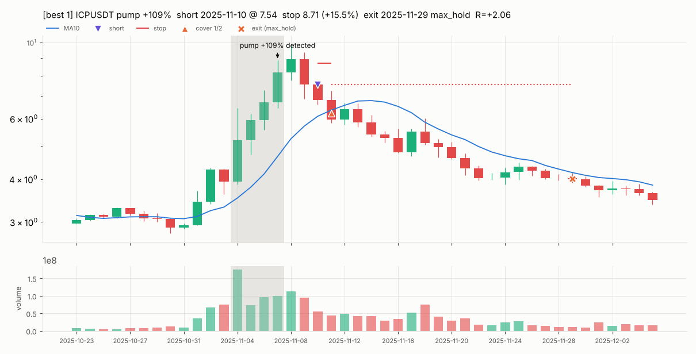
**最好 2. GTCUSDT** R = +1.99

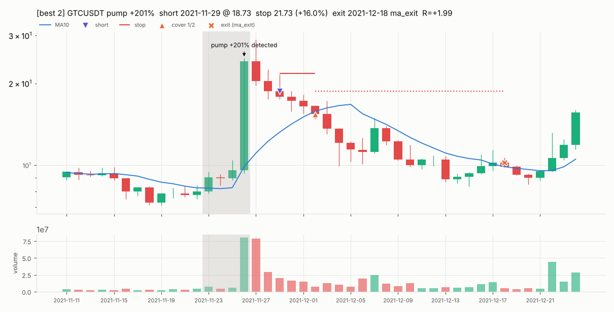
**最好 3. XPLUSDT** R = +1.94

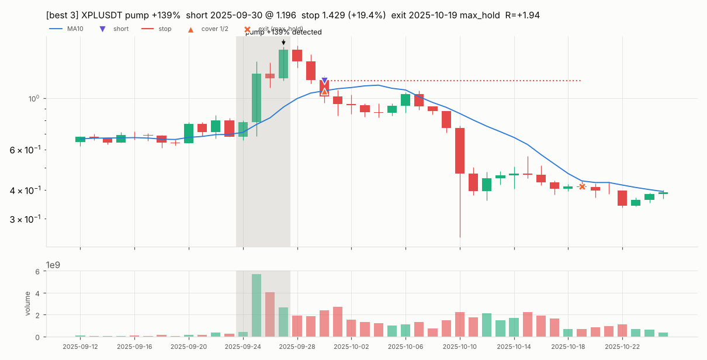
**最好 4. BICOUSDT** R = +1.76

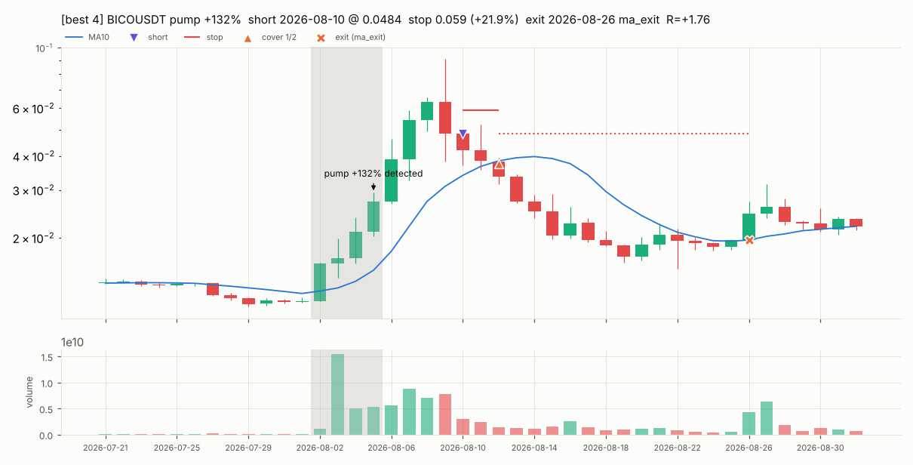
**最好 5. APEUSDT** R = +1.73

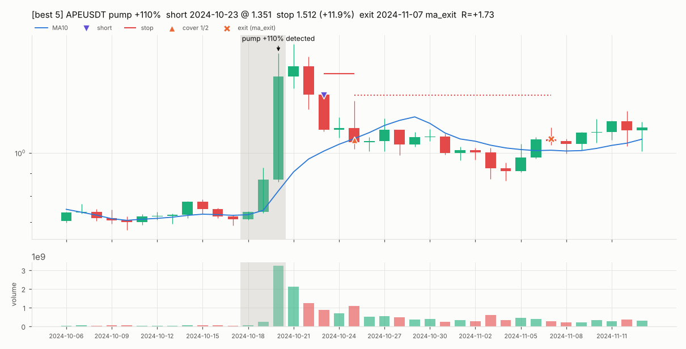
**最好 6. CVXUSDT** R = +1.66

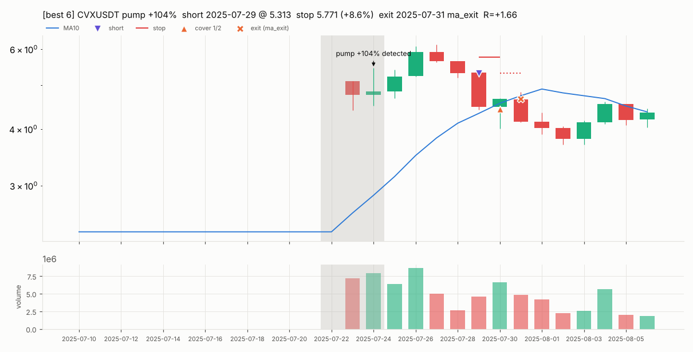
**最好 7. BAKEUSDT** R = +1.56

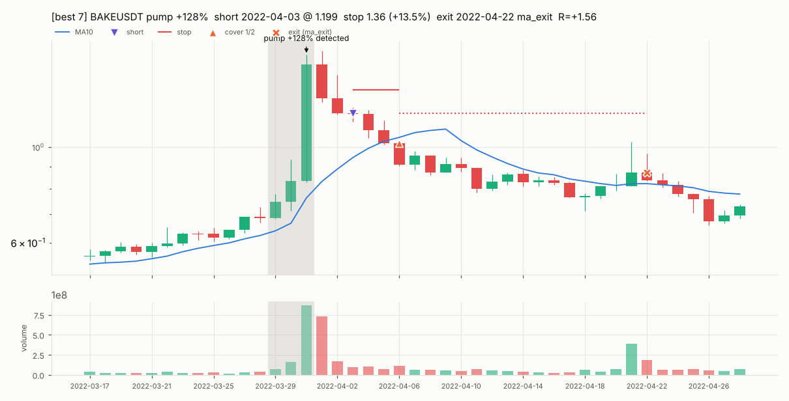
**最好 8. FRONTUSDT** R = +1.54

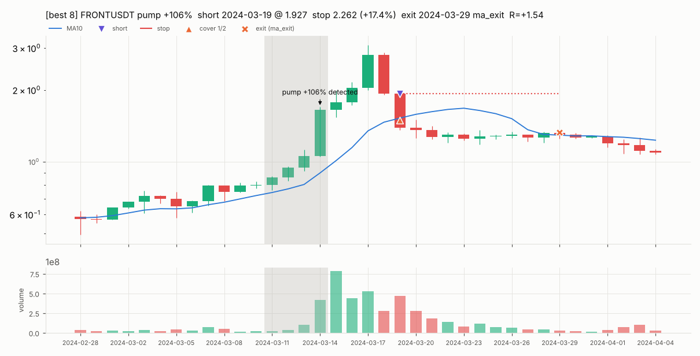
**最好 9. RIVERUSDT** R = +1.52

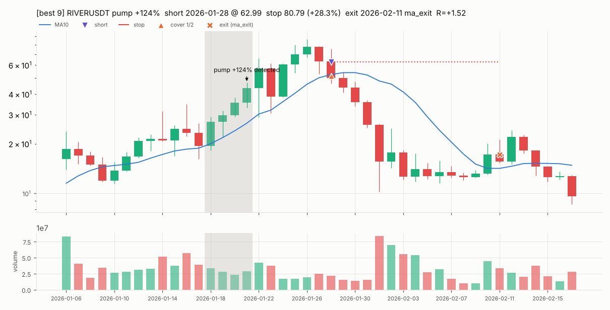
**最好 10. IDOLUSDT** R = +1.38

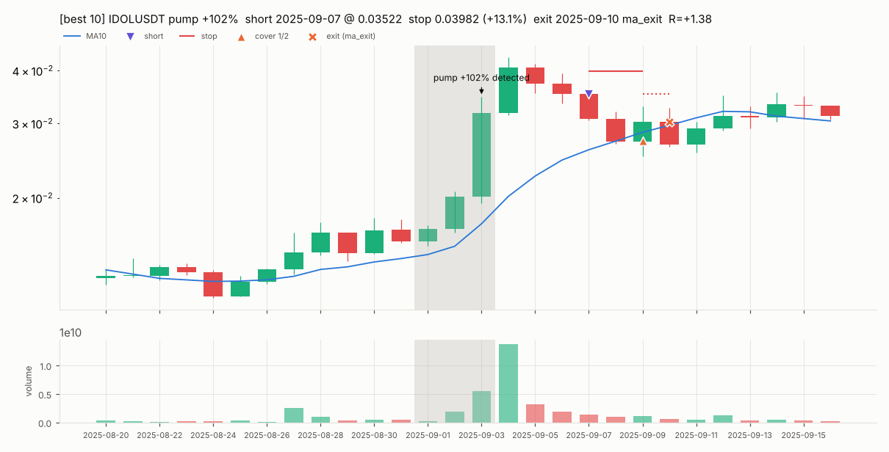
**最差 1. FHEUSDT** R = -3.65

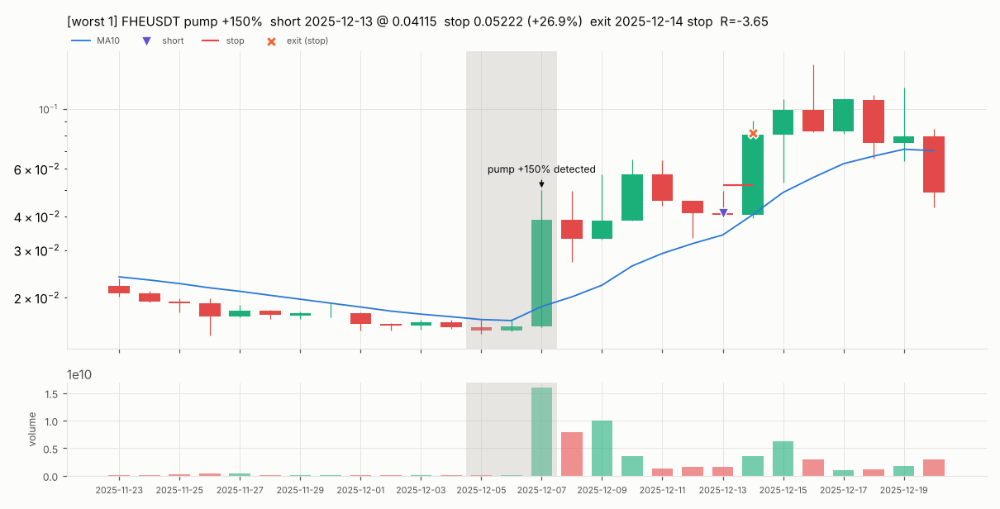
**最差 2. TAUSDT** R = -2.66

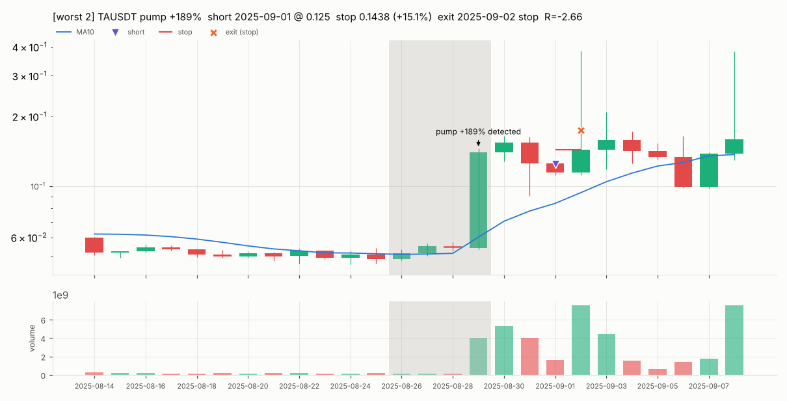
**最差 3. GUAUSDT** R = -2.29

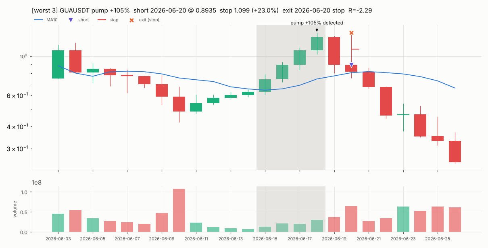
**最差 4. RAREUSDT** R = -2.28

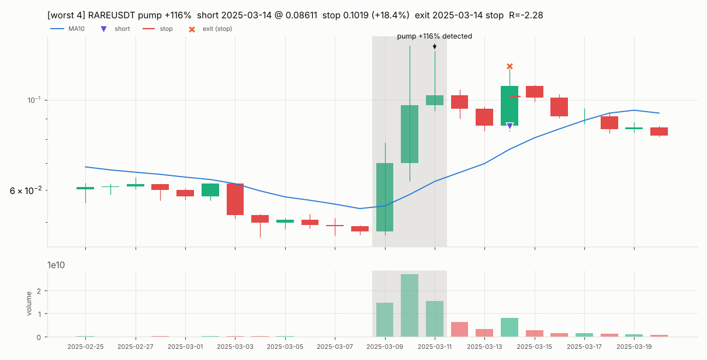
**最差 5. BTRUSDT** R = -2.16

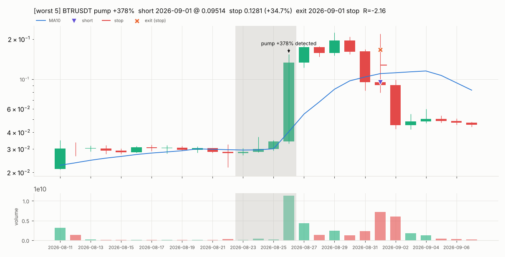
**最差 6. BLESSUSDT** R = -2.04

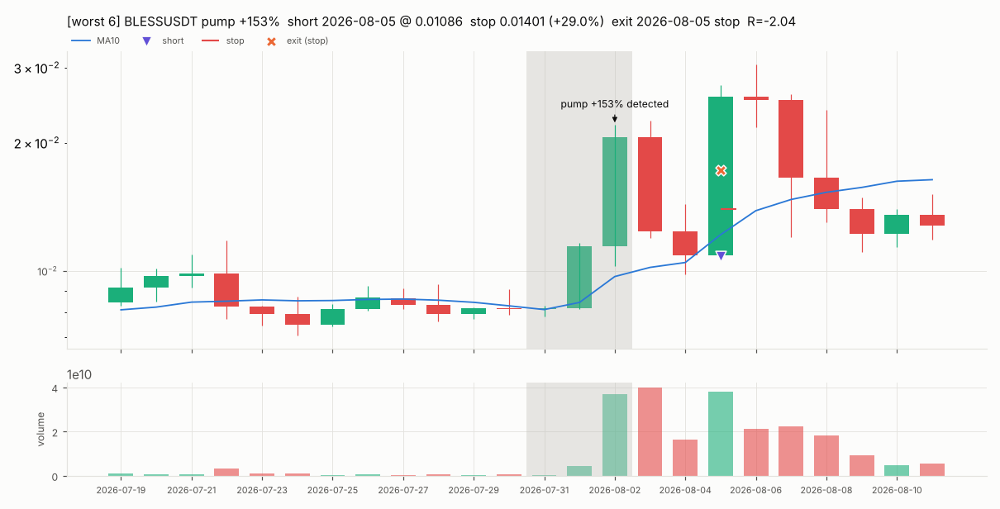
**最差 7. ALCHUSDT** R = -2.03

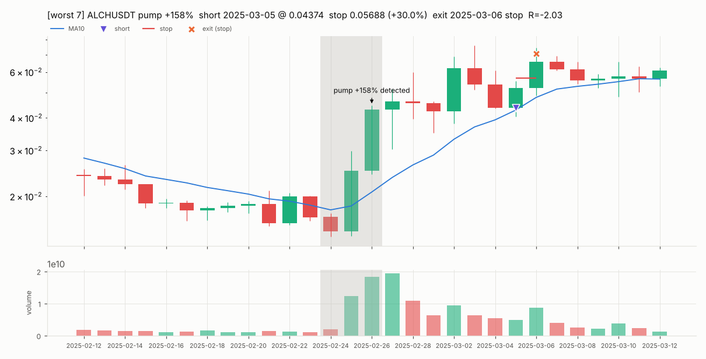
**最差 8. ZBTUSDT** R = -1.95

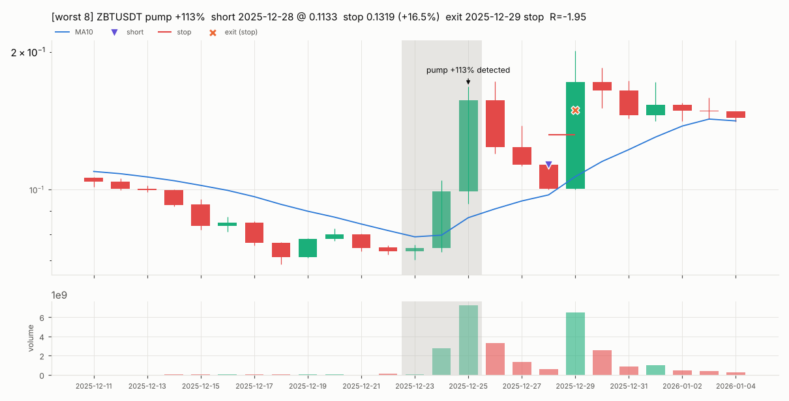
**最差 9. DASHUSDT** R = -1.94

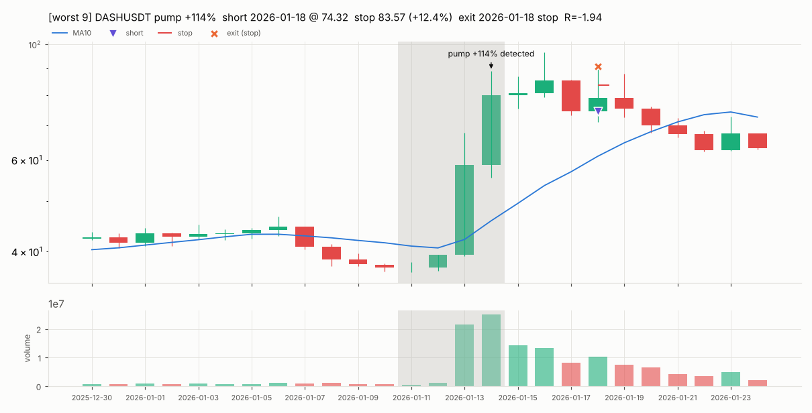
**最差 10. 龙虾USDT** R = -1.80

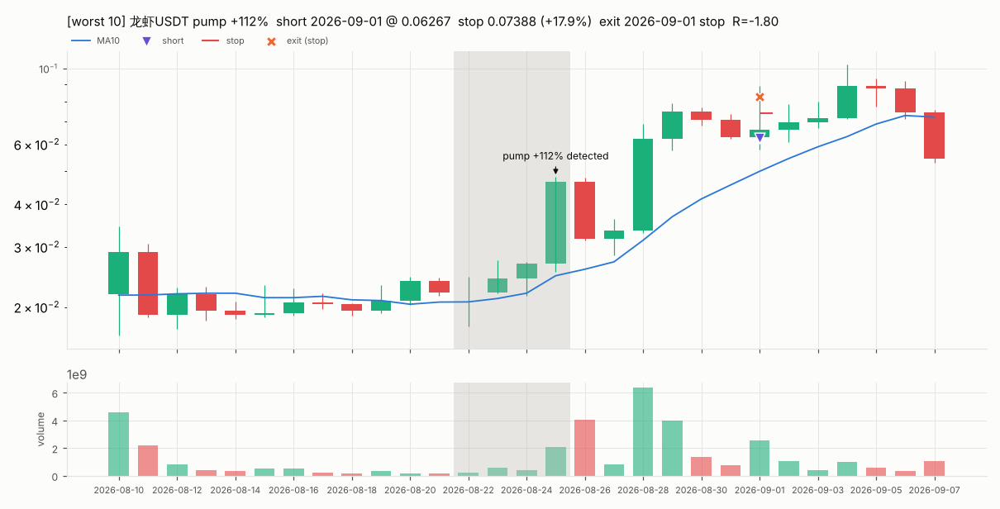

## 7. 在美国以散户身份做空加密货币:合规渠道和限制

> 以下只列公开报道中的事实,**全部需要你自己再向券商/交易所/律师核实**;
> 加密衍生品监管在 2025–2026 年变化很快,条款随时可能更新。不构成法律或投资建议。

**(1)合规的美国境内渠道(CFTC 监管的期货/永续)——标的都是大市值币,基本没有暴涨小币**

- **Coinbase Derivatives(CFTC 监管的指定合约市场 DCM)**:2025 年 7 月推出面向美国的“永续式期货”
  (perpetual-style futures,名义上 5 年到期,按小时结算资金费,最高约 10 倍杠杆),起步为 nano BTC / nano ETH;
  2025 年 11 月宣布扩展到 ADA、AVAX、BCH、LINK、DOGE、HBAR、LTC、DOT、SHIB、XLM、SUI 等。
  注意:Coinbase 现货高级交易的吃单费率档位(约 0.6%)和衍生品的按合约收费不是一回事。
- **Kraken(经 Bitnomial,CFTC 监管)**:2026 年 6 月前后向符合条件的美国客户推出 CFTC 监管的永续合约,
  首批 9 个标的:BTC、ETH、SOL、XRP、ADA、LINK、DOGE、LTC、AVAX;8 小时资金费。
- **Kalshi**:报道称 2026 年 5 月 CFTC 批准了其比特币永续合约。另有报道称 CFTC 允许把普通期货转成永续的临时不行动函
  (no-action letter)在 2026 年 6 月底到期——是否延期需要核实。
- **CME 期货**(通过期货券商,如 Interactive Brokers、Robinhood 等):BTC、ETH 及微型合约;
  2025 年 3 月上线 SOL 期货(标准 500 SOL / 微型 25 SOL),2025 年 5 月上线 XRP 期货(标准 50,000 / 微型 2,500 XRP),
  2025 年 10 月计划上线 SOL、XRP 期货期权。CME 期货有到期日、需要期货账户审批和保证金。

**(2)用证券账户间接做空**

- 反向 / 杠杆反向 BTC、ETH ETF(例如 ProShares 的反向比特币 ETF)——只覆盖 BTC/ETH,且每日再平衡有损耗。
- 在保证金账户里融券卖空现货加密 ETF(如比特币/以太坊现货 ETF):需要保证金账户审批、可借券、借券费,
  适用 Reg T 等保证金规则;同样只覆盖大市值币。

**(3)离岸平台和 DeFi 的限制**

- **Binance.com**:其用户条款长期写明不向美国人士提供服务(2019–2020 年起开始屏蔽美国用户,美国用户被引导到
  Binance.US,而后者不提供合约)。
- **Hyperliquid**:前端界面把位于/居住在美国的人列为“受限人士”,并封锁美国 IP;dYdX 的前端同样屏蔽美国用户。
  有观点认为智能合约本身与前端不同,但这不是定论,且绕过封锁违反用户条款。
- 用 VPN 等方式绕过地域限制,违反平台条款,可能导致账户冻结、资产无法提取,并有法律风险;
  CFTC 的立场是面向美国散户的杠杆加密商品交易需要在注册平台进行。

**(4)对本策略的实际含义**

本策略做空的对象是 3–4 天翻倍以上的小币,**这些币在美国合规平台上通常根本没有可做空的合约**;
能合规做空的只有 BTC、ETH、SOL、XRP 等少数大币,而它们几乎不会出现 3–4 天涨 100% 的行情。
所以在美国合规框架内,这个策略基本没有可执行的标的。

来源(需要核实最新情况):
[Coinbase: US Perpetual-Style Futures](https://www.coinbase.com/blog/coming-july-21-us-perpetual-style-futures) ·
[The Block: Coinbase Derivatives 扩展山寨币](https://www.theblock.co/post/380028/coinbase-derivatives-to-expand-24-7-futures-trading-for-bevy-of-altcoins-including-ada-avax-doge-and-shib) ·
[The TRADE: Kraken CFTC 永续](https://www.thetradenews.com/kraken-launches-first-cftc-regulated-perpetual-futures-for-us-traders/) ·
[Crypto Times: Kraken 2026-06](https://www.cryptotimes.io/2026/06/15/kraken-rolls-out-cftc-regulated-perpetual-futures-to-us-clients/) ·
[Blockworks: CME SOL/XRP](https://blockworks.com/news/cme-group-solana-xrp-futures) ·
[Cointelegraph: CME XRP 期货](https://cointelegraph.com/news/chicago-mercantile-exchange-cme-group-to-launch-xrp-futures) ·
[The Block: Binance 屏蔽美国用户](https://www.theblock.co/news/markets/2020-11-24-binance-blocking-us-users-14-day-deadline-new-email-85589) ·
[OneKey: Hyperliquid / dYdX 地域限制](https://onekey.so/blog/ecosystem/geo-block-hyperliquid-dydx-us/)

## 8. 局限

- 日线 + 4h 回测看不到更细的盘中顺序;已按对空头最不利的顺序处理,但真实的爆仓/插针可能更极端。
- 滑点固定 0.2%,暴涨小币的真实滑点(尤其止损时)可能大得多;没有模拟强平、保证金追加、自动减仓(ADL)。
- 资金费用的是币安数据;换到美国合规平台,资金费机制和标的都不同(见第 7 节)。
- 只有当时有永续合约的币才在样本里;暴涨事件数量有限,结论的置信区间很宽。

## 9. 总结

**一、是否有稳定正期望:没有稳定的正期望。** 按预定规则在 2020–2023 选中“100% · 日线收盘破前低 · 1×ATR 止损”,样本内 84 笔、每笔 -0.060R;**样本外(2024 至今)333 笔、每笔 -0.165R**(手续费 0.6% 时 -0.209R)。12 个变体里,样本外期望为正的有 0/12 个(0.1% 手续费)、0/12 个(0.6% 手续费)。连最低的 0.05% 手续费下也全部为负,说明亏损不是成本造成的,而是入场本身没有优势:暴涨币在“走弱”之后经常再次拉升,一半仓位平掉后剩下的一半大多被保本止损扫掉,盈亏比只有 0.78。样本内交易数偏少(100% 阈值 84 笔,200%/300% 只有个位数到十几笔),但样本外有 333 笔,结论方向一致。

**二、最大的尾部风险:暴涨后的二次拉升(轧空)+ 跳空,让单笔亏损远超 1R。** 选中变体全区间单笔最大亏损 -3.65R(FHEUSDT 2025-12-13),超过 2R 的有 7 笔;最长连亏 14 笔。蒙特卡洛 1000 次的最大回撤中位数 -26.8%、95% 分位 -28.5%(约 -67R)。12 个变体全区间里最差的单笔是 -8.40R(4h 入场变体,如 2025 年 4 月 ALPACA 下架前的轧空:一天从 0.19 拉到 1.48)。做空的收益上限是 100%,亏损理论上没有上限;止损单在急涨中按更差的价格成交,资金费在轧空时会转为空头支付(平均每笔资金费 -0.006R)。历史样本里没出现的更极端轧空(比如一天再涨几倍、交易所暂停、ADL 自动减仓)回测完全覆盖不到。

**三、美国散户合规渠道:能合规做空的几乎只有大币,而本策略的标的是暴涨小币。** 境内可用的是 CFTC 监管的期货/永续(Coinbase Derivatives、Kraken 经 Bitnomial、CME 期货经期货券商等,标的以 BTC、ETH、SOL、XRP 和少数大市值山寨币为主),或用证券账户买反向 BTC/ETH ETF、融券卖空加密 ETF;Binance.com、Hyperliquid、dYdX 等离岸/去中心化平台的条款不允许美国用户,绕过地域限制有冻结和法律风险。具体标的、杠杆、资金费机制和准入条件变化很快,以上均需自行核实(详见第 7 节)。
